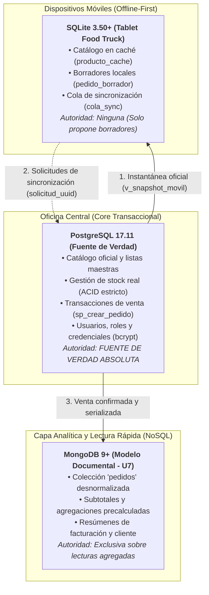

# Base de Datos 2 — Food Store
## Proyecto Integrador · Segunda Entrega Parcial (TPI 2)
### Asignatura: Base de Datos II — Tecnicatura Universitaria en Programación (UTN)

Repositorio oficial del proyecto integrador **«Food Store»** desarrollado para la cátedra de **Base de Datos II** (UTN — Facultad Regional Tucumán).

El repositorio documenta el avance progresivo de todas las unidades de la materia y consolida las dos grandes entregas del Trabajo Práctico Integrador:
1. **Primera Entrega Parcial del TPI (Unidades 1, 2 y 3):** Integridad relacional, transacciones ACID, concurrencia, optimización con índices y vistas en PostgreSQL.
2. **Segunda Entrega Parcial del TPI (Unidades 4 a 8):** Capa de datos integral del proyecto — Normalización avanzada (FNBC) y desnormalización controlada, administración y seguridad bajo mínimo privilegio, mantenimiento preventivo y recuperación ante desastres, persistencia documental NoSQL con MongoDB y bases móviles desconectadas con SQLite.

---

## 1. Estado Actual del Proyecto: Segunda Entrega Parcial (TPI 2)

El estado actual del repositorio consolida la **Segunda Entrega Parcial del TPI**, integrando armónicamente una arquitectura de datos distribuida y políglota con tres motores especializados:

* **Rama activa de entrega:** `tpi-parcial2` (con base en `tp10-moviles-integracion`).
* **Regla de Oro:** *"El móvil propone, el servidor dispone"*. PostgreSQL es la única fuente de verdad sobre stock, precios y ventas.
* **Motores integrados y certificados:**
  - **PostgreSQL 16+ (PostgreSQL 17.11 en Windows):** Núcleo transaccional ACID central (`foodstore` / `bd2_tp7`).
  - **MongoDB 9+ (MongoDB 9.0.4 Community):** Capa documental para lecturas agregadas y dashboards (`foodstore_nosql`).
  - **SQLite 3.37+ (SQLite 3.50.4 embebido):** Almacenamiento local en tablets móviles en modo `STRICT` (`movil/foodstore_movil.db`).
* **Herramientas de IA y Gobernanza:** Kiro (especificaciones en notación formal EARS), OpenCode y Antigravity, con bitácora crítica documentada y cumplimiento estricto del protocolo de uso de IA y la Ley Nacional 25.326.

---

## 2. Arquitectura Integral y Reparto de Responsabilidades



| Motor | Rol Arquitectónico | Datos Almacenados | Autoridad Decisoria | Tecnologías Clave |
| :--- | :--- | :--- | :--- | :--- |
| **PostgreSQL 17.11** | **Núcleo Transaccional Central** | Catálogo oficial maestro, inventario en tiempo real, clientes, pedidos formales confirmados, líneas de detalle, credenciales criptográficas y trazas de auditoría. | **Fuente de Verdad Única (*Single Source of Truth*)**. Autoridad absoluta sobre precios vigentes, asignación de stock y confirmación de ventas bajo aislamiento ACID. | PL/pgSQL, `pgcrypto`, `TIMESTAMPTZ`, triggers diferibles, vistas materializadas. |
| **MongoDB 9.0.4** | **Capa Documental y Analítica** | Colección documental desnormalizada `pedidos`, conteniendo cabeceras, subdocumentos de clientes, arreglos de líneas con subtotales precalculados e importes totales. | **Autoridad delegada de lectura agregada**. Optimiza dashboards y reporting de alta concurrencia sin recargar el motor OLTP relacional. | BSON, Aggregation Framework, *Single-Document Atomicity*, índices multikey. |
| **SQLite 3.50.4** | **Capa de Movilidad Desconectada** | Caché local del catálogo (`producto_cache`), borradores transitorios (`pedido_borrador`, `item_borrador`) y estados del semáforo (`cola_sync`). | **Sin autoridad decisoria**. Libreta de trabajo desconectada que únicamente prepara borradores para someter a evaluación del servidor. | Modo `STRICT`, precios en centavos enteros (`INTEGER`), claves foráneas activas. |

---

## 3. Cobertura de Objetivos del Programa (Unidades 4 a 8)

1. **Unidad 4 · Normalización avanzada y redundancia:**
   - Refactorización de `control_lote_almacen` hasta la Forma Normal de Boyce-Codd (FNBC) validada mediante dependencias funcionales reales y Criterio de Heath (`db/tp_fnbc_control_lote.sql`).
   - Migración de datos sin pérdida en transacciones reversibles (`BEGIN ... COMMIT / ROLLBACK`) con especificación Kiro y plan de reversión obligatorio (`docs/tp6/kiro/rollback_plan.md`).
   - Desnormalización controlada mediante la vista materializada `mv_ventas_categoria_dia`, índice único compuesto, refresco concurrente y auditoría con `FULL OUTER JOIN` (`db/tp_desnormalizacion_top_categorias.sql`).
2. **Unidad 5 · Administración y seguridad:**
   - Esquema de roles y permisos jerárquicos bajo el principio de mínimo privilegio (revocación de `DELETE/TRUNCATE`, permisos a nivel de columna para soporte, exclusión de `SUPERUSER` en `sql/roles.sql`).
   - Auditoría nativa del servidor activada (`log_statement = 'mod'`), simulacro de acceso indebido reproducido y protocolo de contención inmediata vía `fn_resetear_password` (`sql/simulacro_incidente.sql`).
   - Auditoría de seguridad asistida por IA con decisión crítica humana documentada y dataset anonimizado `usuario_anon` según Ley 25.326 (`sql/usuario_anon.sql`).
3. **Unidad 6 · Mantenimiento y continuidad operativa:**
   - Plan de mantenimiento completo automatizado en PowerShell/Bash (`docs/tp8/SPEC_U6.md`, `docs/tp8/backup_foodstore.ps1`), diagnóstico en 4 dimensiones (`sql/health_check.sql`) y mantenimiento seguro no bloqueante con `VACUUM ANALYZE` (veto a `VACUUM FULL` en `sql/maintenance.sql`).
   - Simulacro de desastre contra reloj (`docs/tp8/restore_test.ps1`), RTO cronometrado en 2,84 segundos, RPO inferior a 15 minutos e informe post-incidente con 0 discrepancias (`docs/tp8/informe_u6.md`).
4. **Unidad 7 · NoSQL y almacenamiento documental:**
   - Modelado documental de pedidos en MongoDB (`foodstore_nosql`) bajo el patrón *Aggregate Root*, migración de datos reales y ejecución de consultas documentales 4a a 4d (`docs/tp9/consultas_mongodb.js`).
   - Comparación práctica contra consultas SQL equivalentes en PostgreSQL, análisis de arreglos vs. JOINs y justificación técnica de la persistencia políglota (`docs/tp9/consultas_postgresql.sql`).
5. **Unidad 8 · Bases de datos móviles e integración:**
   - Base de datos SQLite embebida en modo `STRICT`, precios en centavos enteros (`INTEGER`), claves foráneas activas y especificación Kiro (`movil/schema_sqlite.sql`).
   - Sincronización simulada contra servidor mediante el algoritmo del Semáforo y resolución de conflictos (casos C1 a C7: stock, cambios tarifarios, lápidas e idempotencia en `movil/simulador_casos.py`).
   - Code review asistido por IA de los scripts de la cursada con decisiones humanas fundadas.
6. **Capa de datos integral:** Integración coordinada de los tres motores con especificaciones, scripts versionados y bitácora de IA lista para su defensa oral (`db/tpi_parcial2_pruebas.sql`).

---

## 4. Estructura del Repositorio

```text
Food-Store/
├── README.md                                # Este documento (Guía central de navegación)
├── BITACORA.md                              # Bitácora histórica del repositorio
├── recrear_base_foodstore.ps1               # Script automatizado de recreación integral (PowerShell)
├── recrear_base_foodstore.sh                # Script automatizado de recreación integral (Bash)
│
├── db/                                      # Scripts SQL centrales del proyecto
│   ├── schema.sql                           # Esquema DDL relacional (fuente de verdad)
│   ├── indices.sql                          # Índices del modelo transaccional
│   ├── views.sql                            # Vistas base del sistema
│   ├── generador_datos_tp3_carga.sql        # Carga masiva de datos iniciales
│   ├── tp_fnbc_control_lote.sql             # U4: Refactorización FNBC y migración reversible
│   ├── tp_desnormalizacion_top_categorias.sql # U4: Vista materializada y auditoría
│   ├── roles.sql                            # U5: Jerarquías de roles y mínimo privilegio
│   ├── auditoria_test.sql                   # U5: Prueba de auditoría nativa
│   ├── simulacro_incidente.sql              # U5: Laboratorio de acceso indebido
│   ├── usuario_anon.sql                     # U5: Dataset anonimizado (Ley 25.326)
│   ├── tpi_parcial1_pruebas.sql             # Pruebas consolidadas del 1° Parcial
│   └── tpi_parcial2_pruebas.sql             # SUITE CENTRAL DE PRUEBAS DEL 2° PARCIAL
│
├── sql/                                     # Entregables SQL canónicos de mantenimiento
│   ├── health_check.sql                     # U6: Monitoreo preventivo en 4 dimensiones
│   └── maintenance.sql                      # U6: VACUUM ANALYZE no bloqueante
│
├── movil/                                   # Capa móvil y de sincronización (Unidad 8)
│   ├── schema_sqlite.sql                    # Esquema SQLite en modo STRICT
│   ├── pruebas_sqlite.sql                   # Pruebas unitarias de restricciones y FKs
│   ├── postgresql_snapshot.sql              # Vista oficial v_snapshot_movil en PostgreSQL
│   ├── snapshot_servidor.sql                # Receptora de instantánea en SQLite
│   ├── servidor_snapshot.csv                # Archivo de intercambio de instantánea
│   ├── semaforo.sql                         # Algoritmo de resolución de conflictos
│   ├── simulador_casos.py                   # Suite de simulación automatizada (C2 a C6)
│   ├── ejecutar_pruebas.py                  # Runner de validación de pruebas unitarias
│   └── foodstore_movil.db                   # Archivo físico binario de SQLite
│
└── docs/                                    # Documentación técnica, especificaciones e informes
    ├── tpi_parcial2/                        # CARPETA CENTRAL DE LA SEGUNDA ENTREGA (U4 A U8)
    │   ├── informe_tpi_parcial2.md          # INFORME TÉCNICO CONSOLIDADO DE LA ENTREGA
    │   ├── informe_tpi_parcial2.pdf         # INFORME TÉCNICO EN FORMATO PDF (COMPILADO)
    │   ├── informe_tpi_parcial2.html        # MAQUETADO HTML DE ALTA FIDELIDAD
    │   ├── bitacora_ia_consolidada.md       # BITÁCORA CONSOLIDADA DE IA (UNIDADES 4 A 8)
    │   ├── DUIA.md                          # DECLARACIÓN DE USO DE IA (DUIA OFICIAL)
    │   └── generar_pdf.py                   # Script de compilación HTML a PDF
    │
    ├── tp6/                                 # Histórico TP6: FNBC (con docs/tp6/kiro/)
    ├── tp7/                                 # Histórico TP7: Seguridad (con kiro_roles_spec/)
    ├── tp8/                                 # Histórico TP8: Mantenimiento (SPEC_U6)
    ├── tp9/                                 # Histórico TP9: NoSQL (MongoDB vs. PostgreSQL)
    ├── tp10/                                # Histórico TP10: Móviles (con kiro/)
    └── tpi_parcial1/                        # Histórico Primera Entrega Parcial (U1 a U3)
```

---

## 5. Guía de Reproducción Integral de la Base de Datos desde Cero

Para garantizar la replicabilidad total del proyecto en una máquina estéril, se detallan los procedimientos para los tres motores:

### 5.1. Reproducción del Servidor Central (PostgreSQL 16+)

#### Opción A · Automatizada en un solo comando (Recomendada)
El script `recrear_base_foodstore.ps1` (o su equivalente Bash `.sh`) ejecuta de manera secuencial los 12 pasos acumulados desde la Unidad 1 hasta la Unidad 8:
```powershell
.\recrear_base_foodstore.ps1 -Database foodstore
```
*Salida esperada:*
```text
[+] Base 'foodstore' creada limpiamente.
[+] Paso 2 a 5: Esquema base, índices, carga masiva y vistas (U1-U3).
[+] Paso 6 y 7: FNBC y vista materializada de ventas (U4).
[+] Paso 8 a 11: Seguridad, funciones, roles y dataset anonimizado (U5).
[+] Paso 12: Vista de instantánea v_snapshot_movil (U8).
 ¡RECREACIÓN INTEGRAL DE 'foodstore' COMPLETADA CON ÉXITO!
```

#### Opción B · Manual paso a paso con `psql`
En una consola conectada como usuario administrativo:
```powershell
# 1. Crear base vacía
psql -U postgres -c "DROP DATABASE IF EXISTS foodstore; CREATE DATABASE foodstore;"

# 2. Núcleo relacional e índices (U1-U3)
psql -U postgres -d foodstore -v ON_ERROR_STOP=1 -f db/schema.sql
psql -U postgres -d foodstore -v ON_ERROR_STOP=1 -f db/indices.sql
psql -U postgres -d foodstore -v ON_ERROR_STOP=1 -f db/generador_datos_tp3_carga.sql
psql -U postgres -d foodstore -v ON_ERROR_STOP=1 -f db/views.sql

# 3. FNBC y desnormalización controlada (U4)
psql -U postgres -d foodstore -v ON_ERROR_STOP=1 -f db/tp_fnbc_control_lote.sql
psql -U postgres -d foodstore -v ON_ERROR_STOP=1 -f db/tp_desnormalizacion_top_categorias.sql

# 4. Administración, seguridad y roles (U5)
psql -U postgres -d foodstore -v ON_ERROR_STOP=1 -f db/tp7_clase1_prerrequisitos.sql
psql -U postgres -d foodstore -v ON_ERROR_STOP=1 -f db/tp7_clase2_seguridad.sql
psql -U postgres -d foodstore -v ON_ERROR_STOP=1 -f sql/roles.sql
psql -U postgres -d foodstore -v ON_ERROR_STOP=1 -f sql/usuario_anon.sql

# 5. Vista de instantánea móvil (U8)
psql -U postgres -d foodstore -v ON_ERROR_STOP=1 -f movil/postgresql_snapshot.sql
```

---

### 5.2. Reproducción de la Capa Móvil Desconectada (SQLite 3.50+)

1. **Construcción de la Base y Pruebas Unitarias de Integridad:**
   ```powershell
   python movil/ejecutar_pruebas.py
   ```
   *Crea `movil/foodstore_movil.db` desde cero aplicando `schema_sqlite.sql`, verifica claves foráneas activas y comprueba el rechazo de datos inválidos (Caso C7).*

2. **Simulación Integral del Semáforo de Conflictos (Casos C2 a C6):**
   ```powershell
   python movil/simulador_casos.py
   ```
   *Ejecuta la suite que prueba la resolución de cambios de precio en mostrador (C2), quiebres de stock en cocina (C3), productos dados de baja lógica (C4), solicitudes limpias (C5) e idempotencia ante reintentos de red (C6), verificando que el stock de PostgreSQL permanezca inalterado.*

---

### 5.3. Reproducción de la Capa Documental NoSQL (MongoDB 9+)

Inicie el servicio de MongoDB (`mongod`) y ejecute el script de migración y consultas:
```powershell
mongosh --quiet --file docs/tp9/consultas_mongodb.js
```
*Crea la base `foodstore_nosql`, la colección `pedidos`, migra los 5 documentos con subtotales precalculados y ejecuta las consultas 4a a 4d.*

---

### 5.4. Verificación de Continuidad: Simulacro de Desastre (Disaster Recovery)

Ejecute el ensayo de recuperación ante desastres sobre entorno aislado:
```powershell
powershell -ExecutionPolicy Bypass -File docs/tp8/restore_test.ps1 -SourceDatabase foodstore -RestoreDatabase foodstore_restore_test
```
*Crea la base descartable, restaura el último backup custom (`-Fc`), cronometra el RTO (< 15 min) y valida las 7 aserciones de integridad con 0 discrepancias.*

---

### 5.5. Suite Central de Pruebas Reproducibles de la Segunda Entrega

Una vez inicializados los motores, ejecute la suite de verificación integrada en PostgreSQL:
```powershell
psql -U postgres -d foodstore -f db/tpi_parcial2_pruebas.sql
```
*Valida de forma automática y controlada: pérdida cero de FNBC, consulta desnormalizada, auditoría sin discrepancias, catálogo de roles sin superusuario, ausencia de DELETE en app_web, autenticación segura, contención de incidentes, métricas de salud y consultas de contraste NoSQL.*

---

## 6. Documentación Oficial de la Segunda Entrega

* **Informe Técnico Oficial:** [`docs/tpi_parcial2/informe_tpi_parcial2.md`](file:///d:/formateo%20win%2011/Estudios%20(Nuevo)/utn%20tec.%20programación/3°%20Semestre/Base%20de%20Datos%202/Food-Store/docs/tpi_parcial2/informe_tpi_parcial2.md)
* **Versión Oficial en PDF:** [`docs/tpi_parcial2/informe_tpi_parcial2.pdf`](file:///d:/formateo%20win%2011/Estudios%20(Nuevo)/utn%20tec.%20programación/3°%20Semestre/Base%20de%20Datos%202/Food-Store/docs/tpi_parcial2/informe_tpi_parcial2.pdf)
* **Bitácora Crítica de IA:** [`docs/tpi_parcial2/bitacora_ia_consolidada.md`](file:///d:/formateo%20win%2011/Estudios%20(Nuevo)/utn%20tec.%20programación/3°%20Semestre/Base%20de%20Datos%202/Food-Store/docs/tpi_parcial2/bitacora_ia_consolidada.md)
* **Declaración de Uso de IA (DUIA):** [`docs/tpi_parcial2/DUIA.md`](file:///d:/formateo%20win%2011/Estudios%20(Nuevo)/utn%20tec.%20programación/3°%20Semestre/Base%20de%20Datos%202/Food-Store/docs/tpi_parcial2/DUIA.md)
* **Suite de Verificación:** [`db/tpi_parcial2_pruebas.sql`](file:///d:/formateo%20win%2011/Estudios%20(Nuevo)/utn%20tec.%20programación/3°%20Semestre/Base%20de%20Datos%202/Food-Store/db/tpi_parcial2_pruebas.sql)
