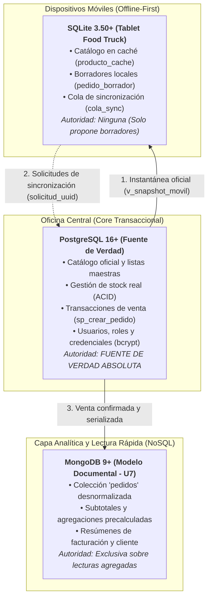

# FOOD STORE - PROYECTO INTEGRADOR
## Trabajo Práctico N.º 8 (TP10) · Unidad 8: Bases de Datos Móviles e Integración
**Materia:** Base de Datos II - Tecnicatura Universitaria en Programación (UTN)  
**Herramientas:** PostgreSQL 16+ · SQLite 3.37+ · Kiro y OpenCode  
**Fecha:** Noviembre 2026  

---

## 1. La Base de la Tablet

### 1.a Qué datos viajan al dispositivo móvil

Para operar el Food Truck en una feria gastronómica sin conectividad garantizada, la base de datos embebida (SQLite) en la tablet debe contar con la información mínima indispensable para atender al público y confeccionar borradores de pedidos.

| Entidad / Atributo | ¿Viaja a la tablet? | Justificación técnica y de seguridad |
| :--- | :---: | :--- |
| **`producto (id, nombre)`** | **SÍ** | Requerido para confeccionar y presentar la carta/menú en la interfaz de venta. |
| **`producto (precio)`** | **SÍ** | Se almacena en centavos (`precio_centavos INTEGER`) para informar el precio de lista al cliente y evitar imprecisiones de redondeo en coma flotante. |
| **`producto (stock)`** | **SÍ** | Viaja como `stock_visto INTEGER`, con carácter meramente orientativo; no autoriza ventas por sí solo. |
| **`producto (disponible)`** | **SÍ** | Permite ocultar temporalmente productos agotados o fuera de menú (`disponible_visto IN (0,1)`). |
| **`producto / categoria (eliminado)`** | **SÍ** | Viaja como "lápida" (*tombstone*). Permite ocultar el producto del catálogo activo sin romper la integridad referencial de borradores previos. |
| **`cliente / usuario (contraseñas, hashes)`** | **NO** | Crítico. Nunca deben abandonar el servidor central para prevenir filtraciones en caso de robo o pérdida de la tablet. |
| **`cliente (email, teléfono, domicilio)`** | **NO** | Datos personales innecesarios para la toma de pedidos presencial en mostrador (cumplimiento Ley 25.326 de Protección de Datos Personales). |
| **`pedido / detalle_pedido (historial global)`** | **NO** | La tablet no procesa reportes ni auditorías; sobrecargar el almacenamiento local degrada la memoria y batería del dispositivo. |
| **`pagos (datos de tarjetas, transferencias)`** | **NO** | Los cobros y conciliaciones financieras son responsabilidad del servidor o terminales de pago certificadas. |

#### Justificación y Fuente de Verdad
1. **Por qué:** Aplicamos el principio de mínimo privilegio y minimización de datos (Art. 4 y 9 de la Ley Nacional 25.326). La tablet almacena únicamente el catálogo operativo necesario para armar carritos de compras *offline*. En caso de extravío o sustracción física del dispositivo en la feria, no existe exposición de datos confidenciales ni transaccionales de clientes.
2. **Quién es la fuente de verdad:** **PostgreSQL** es la única e indiscutible fuente de verdad (*Single Source of Truth*). La base de la tablet actúa como una libreta de borradores temporales. La tablet nunca altera stock, nunca actualiza precios de lista centrales y nunca confirma ventas por su cuenta: **el móvil propone, el servidor dispone**.

---

## 2. Sincronizar y Resolver: El Semáforo

### 2.a Instantánea del servidor y exportación

La sincronización se basa en operaciones asimétricas con roles estrictamente delimitados:
1. **Descarga y Exportación Central:** El servidor PostgreSQL publica la vista `v_snapshot_movil` con fecha de toma precisa en microsegundos y precios expresados en centavos enteros. Se exporta directamente a `movil/servidor_snapshot.csv` mediante `\copy (SELECT * FROM v_snapshot_movil) TO 'movil/servidor_snapshot.csv' CSV HEADER;`. En la vista, las columnas booleanas `disponible` y `eliminado` son complementos lógicos estrictos (`disponible = (p.activo AND c.activa)` y `eliminado = (NOT p.activo OR NOT c.activa)`), por lo que nunca pueden ser simultáneamente verdaderas ni falsas.
2. **Importación y Recarga Oficial:** En SQLite se importa el CSV a la tabla `snapshot_servidor`, y desde allí se ejecuta la consulta oficial de recarga del catálogo para sincronizar `producto_cache`.
3. **Envío (Cola de Sincronización):** Los borradores locales se encolan con identificadores únicos `solicitud_uuid` generados en el dispositivo móvil.

```sql
-- Vista en PostgreSQL (postgresql_snapshot.sql)
CREATE OR REPLACE VIEW v_snapshot_movil AS
SELECT 
    p.id_producto                       AS producto_id,
    p.nombre                            AS nombre,
    (p.precio * 100)::INTEGER           AS precio_centavos,
    p.stock                             AS stock,
    (p.activo AND c.activa)             AS disponible,
    (NOT p.activo OR NOT c.activa)      AS eliminado,
    now()                               AS capturado_en
FROM producto p
JOIN categoria c ON c.id_categoria = p.categoria_id;
```

### 2.b Reglas del Semáforo

El script `semaforo.sql` evalúa exclusivamente las solicitudes en estado `PENDIENTE` comparando cada ítem del borrador contra `snapshot_servidor`.

* **ROJO (`RECHAZADO`):** Si algún ítem no existe en el catálogo, no está disponible para la venta, tiene lápida activa (`eliminado = 't'`) o la cantidad requerida supera el stock del servidor.
* **AMARILLO (`CONFLICTO`):** Si no hay condiciones de rechazo, pero el precio visto por el cliente difiere del precio vigente en el servidor.
* **VERDE (`SIMULADO_APROBADO`):** Si todos los ítems coinciden exactamente en disponibilidad, stock y precio.

> **Regla de Prioridad:** El ROJO tiene precedencia absoluta sobre el AMARILLO. Si un pedido contiene un producto con quiebre de stock y otro con aumento de precio, se marca como `RECHAZADO`, dado que negociar el precio es estéril si el producto físicamente no está disponible.

---

### 2.c Comprobación de los Casos de Prueba (C2 a C6)

Los 5 escenarios fueron modelados a partir de las operaciones en la base central PostgreSQL (documentadas en `movil/servidor_casos_c2_c4.sql`) y verificados mediante `movil/simulador_casos.py`, confirmando el comportamiento esperado y la invariabilidad de la base central.

#### Caso C2 · Conflicto de precio resuelto con el cliente
* **Situación:** Se genera un borrador con 1 Pizza Muzzarella al precio visto de $9.000 (`900000` centavos).
* **Modificación en Servidor PostgreSQL (`servidor_casos_c2_c4.sql`):**
  ```sql
  UPDATE producto SET precio = 105.00 WHERE id_producto = 1;
  -- Servidor exporta nueva instantánea desde v_snapshot_movil con precio_centavos = 1050000
  ```
* **Comando y Semáforo (Envío 1):** 
  ```sql
  -- Solicitud inicial enviada con precio visto $9.000 frente a la nueva instantánea
  UPDATE cola_sync SET estado = 'CONFLICTO', motivo = 'CONFLICTO: El precio cambió en el servidor...' WHERE solicitud_uuid = 'solicitud-uuid-c2-envio1';
  ```
* **Resultado:** **`CONFLICTO`**. El semáforo detecta la diferencia tarifaria sin descartar la venta.
* **Resolución y Recarga Oficial (Envío 2):** El cliente acepta pagar $10.500 en mostrador. La tablet **recarga el catálogo oficial** desde la instantánea del servidor (`INSERT OR REPLACE INTO producto_cache SELECT ... FROM snapshot_servidor`), actualiza el ítem del borrador local a `1050000` centavos y reenvía con una nueva solicitud (`solicitud-uuid-c2-envio2`).
  * **Resultado del Semáforo 2:** **`SIMULADO_APROBADO`**.

#### Caso C3 · Quiebre de stock en el servidor
* **Situación:** La tablet toma un pedido de 20 Pizzas Napolitanas (ID 6), cuando el stock real en PostgreSQL es de solo 8 unidades.
* **Comando y Semáforo:**
  ```sql
  -- Evaluación de ítem con cantidad (20) > stock (8)
  UPDATE cola_sync SET estado = 'RECHAZADO', motivo = 'RECHAZADO: Stock insuficiente en el servidor' WHERE solicitud_uuid = 'solicitud-uuid-c3';
  ```
* **Resultado:** **`RECHAZADO`**. La tablet no permite enviar el pedido y advierte al vendedor que la cocina no tiene unidades suficientes. El stock del servidor permanece inalterado en 8 unidades.

#### Caso C4 · Producto dado de baja lógica (Lápida activa)
* **Situación:** Se arma un borrador con 2 Empanadas de Jamón y Queso (ID 7).
* **Modificación en Servidor PostgreSQL (`servidor_casos_c2_c4.sql`):**
  ```sql
  UPDATE producto SET activo = FALSE WHERE id_producto = 7;
  -- v_snapshot_movil exporta para producto 7: disponible = 'f', eliminado = 't' (lápida activa)
  ```
* **Comando y Semáforo:**
  ```sql
  -- Detección de lápida s.eliminado = 't'
  UPDATE cola_sync SET estado = 'RECHAZADO', motivo = 'RECHAZADO: Producto dado de baja en el servidor (lápida activa)' WHERE solicitud_uuid = 'solicitud-uuid-c4';
  ```
* **Resultado:** **`RECHAZADO`**.
* **Recarga Oficial del Catálogo (Consigna 2.c):** La tablet **nunca** marca la baja a mano mediante un `UPDATE` local en `producto_cache`. En su lugar, ejecuta la consulta oficial de recarga de catálogo desde la nueva instantánea del servidor:
  ```sql
  INSERT OR REPLACE INTO producto_cache (
      producto_id, nombre, precio_centavos, stock_visto, disponible_visto, eliminado, capturado_en
  )
  SELECT 
      s.producto_id, s.nombre, s.precio_centavos, s.stock,
      CASE WHEN s.disponible IN ('t', 'true', 'TRUE', '1', 1) THEN 1 ELSE 0 END,
      CASE WHEN s.eliminado IN ('t', 'true', 'TRUE', '1', 1) THEN 1 ELSE 0 END,
      s.capturado_en
  FROM snapshot_servidor s;
  ```
  Al procesar la lápida, `producto_cache` actualiza automáticamente el producto a `eliminado = 1` y `disponible_visto = 0`. El producto desaparece de la vista de ventas `v_catalogo_disponible`, conservando su fila física para mantener la integridad referencial de pedidos y borradores previos.

#### Caso C5 · Solicitud limpia sin alteraciones
* **Situación:** Se genera un pedido por 2 Empanadas de Carne (ID 3) a $1.200 (`120000` centavos), existiendo 20 unidades en stock.
* **Comando y Semáforo:**
  ```sql
  UPDATE cola_sync SET estado = 'SIMULADO_APROBADO', motivo = 'SIMULADO_APROBADO: Todos los ítems cumplen stock, disponibilidad y precio' WHERE solicitud_uuid = 'solicitud-uuid-c5';
  ```
* **Resultado:** **`SIMULADO_APROBADO`**. Indica que el borrador es apto para ser procesado por el servidor cuando exista enlace de red.

#### Caso C6 · Reenvío idéntico (Idempotencia y Clave Primaria)
* **Situación:** La tablet envía la solicitud C5, pero una caída de red impide recibir la confirmación; la tablet reintenta enviar la misma solicitud con el idéntico `solicitud_uuid = 'solicitud-uuid-c5'`.
* **Comando y Semáforo:**
  ```sql
  -- Intento de inserción duplicada en cola_sync
  INSERT INTO cola_sync (solicitud_uuid, id_local, estado) VALUES ('solicitud-uuid-c5', 'local-uuid-c5', 'PENDIENTE');
  -- SQLite: UNIQUE constraint failed: cola_sync.solicitud_uuid
  ```
* **Resultado:** Operación abortada por restricción de Primary Key en SQLite. Al correr nuevamente el semáforo, la fila ya evaluada no cambia su estado ni produce duplicaciones (idempotencia garantizada en la tablet).
* **Protección Real en Producción:**
  En un entorno real de producción, la tablet puede formatearse o fallar; por lo tanto, **la protección definitiva contra duplicaciones debe residir obligatoriamente en el servidor PostgreSQL**. En el servidor se crea una tabla `solicitud_movil (solicitud_uuid UUID PRIMARY KEY, usuario_id BIGINT, pedido_id BIGINT)`. Dentro del procedimiento transaccional `sp_crear_pedido`, se ejecuta un `INSERT INTO solicitud_movil ... ON CONFLICT (solicitud_uuid) DO NOTHING`. Si `NOT FOUND`, la transacción retorna inmediatamente sin crear un segundo pedido ni descontar stock repetido.

---

### Verificación de Invariabilidad en PostgreSQL (Consigna 2.c)

Para corroborar que la simulación cumple con la Regla de Oro (*"El móvil propone, el servidor dispone"*), se verificó en `movil/servidor_casos_c2_c4.sql` que ninguna operación del semáforo ni de la tablet alteró los registros productivos de PostgreSQL:

```sql
-- Consulta en PostgreSQL tras la simulación (servidor_casos_c2_c4.sql)
SELECT 
    (SELECT COUNT(*) FROM pedido) AS total_pedidos_servidor,
    (SELECT SUM(stock) FROM producto) AS stock_total_consolidado;
```
* **Resultado:** La cantidad de pedidos confirmados y el stock consolidado permanecen idénticos a los valores previos a la feria. `SIMULADO_APROBADO` es una simulación de factibilidad, nunca una venta confirmada.

---

## 3. Integrar y Revisar: La Capa de Datos Completa

### 3.a Mapa de la Capa de Datos (Tres motores, una sola fuente de verdad)

La arquitectura de datos de Food Store distribuye responsabilidades entre tres motores de base de datos especializados. Ningún motor compite con otro; cada uno atiende un oficio específico en el ciclo de vida del negocio:



#### Matriz de Responsabilidades y Autoridad

| Motor | Qué guarda | Quién manda sobre cada dato | Construido en |
| :--- | :--- | :--- | :---: |
| **PostgreSQL 16+** | Catálogo oficial de categorías y productos, inventario transaccional, clientes, pedidos formales confirmados, líneas de detalle, credenciales hasheadas (`pgcrypto`) y auditoría. | **Fuente de verdad única (*Single Source of Truth*)**. Posee autoridad inapelable sobre precios vigentes, asignación de stock y confirmación de ventas bajo aislamiento ACID (`SELECT ... FOR UPDATE`). | Unidades 1 a 6 |
| **MongoDB 9+** | Colección documental desnormalizada `pedidos`, conteniendo la cabecera, datos embebidos del cliente, array de ítems y totales precalculados para lectura rápida. | **Autoridad delegada de lectura agregada**. No define stock ni altera precios; almacena una vista materializada de los pedidos para optimizar reporting sin saturar el motor relacional. | Unidad 7 |
| **SQLite 3.37+** | Copia local de lectura del catálogo (`producto_cache`), borradores temporales de pedidos (`pedido_borrador`, `item_borrador`) y estados del semáforo (`cola_sync`). | **Sin autoridad decisoria**. Es una libreta de trabajo desconectada que únicamente prepara borradores para someter a evaluación del servidor: *el móvil propone, el servidor dispone*. | Unidad 8 |

---

### 3.b Plan de Mantenimiento Integral

Como anexo al Plan de Mantenimiento y Recuperación ante Desastres (DRP) desarrollado en la Unidad 6, se incorporan las directivas operativas vinculadas a la flota de dispositivos móviles:

#### 1. ¿Qué se respalda y cómo se prueba la restauración?
* **PostgreSQL:** Se respalda diariamente la base central mediante volcados nativos en formato *custom* comprimido (`pg_dump -Fc`), generando archivos versionados en `db/backups/`. La restauración se prueba en un entorno estéril y automatizado mediante el script `restore_test.ps1` sobre la base descartable `foodstore_restore_test`, verificando la integridad de claves foráneas, funciones y midiendo métricas RTO (Recovery Time Objective) y RPO (Recovery Point Objective).
* **SQLite (Tablets):** Las bases locales embebidas (`foodstore_movil.db`) **no requieren respaldos fríos centralizados**. Al tratarse de un almacenamiento transitorio de conveniencia sin autoridad decisoria, ante una pérdida o rotura de tablet el equipo se reemplaza y descarga una instantánea limpia desde PostgreSQL. Lo único a resguardar son los borradores en `cola_sync` que no hayan podido enviarse, los cuales son auditables localmente.

#### 2. Si se restaura un respaldo viejo de PostgreSQL, ¿qué hacen las tablets?
Si el servidor central sufre un incidente crítico y se restaura un respaldo de días anteriores, las tablets quedan con datos "del futuro" (precios, productos o secuencias que la base restaurada no reconoce).
* **Protocolo de contingencia:**
  1. El servidor PostgreSQL emite una señal de invalidación de versión o cambio de epoch al restaurarse.
  2. Todas las tablets conectadas deben purgar inmediatamente su tabla `snapshot_servidor` y ejecutar una descarga forzada de la vista `v_snapshot_movil` actualizada.
  3. Toda solicitud en `cola_sync` en estado `PENDIENTE` debe volver a ejecutarse a través de `semaforo.sql` para revalidar existencias y precios contra el estado restaurado antes de cualquier confirmación.

#### 3. ¿Cada cuánto y quién revisa las solicitudes en CONFLICTO o RECHAZADO?
* **Frecuencia y Responsable:** La revisión es diaria y obligatoria al cierre de cada turno o jornada de feria por parte del **Encargado de Local / Vendedor del Food Truck**.
* **Tratamiento operativo:**
  * **`CONFLICTO` (Diferencia de precio):** Se resuelve en tiempo real en mostrador; si el comensal acepta el precio actualizado, se reenvía la solicitud; en caso contrario, se desestima el borrador.
  * **`RECHAZADO` (Quiebre de stock o baja):** Se analiza al final del día para detectar discrepancias entre el stock físico del camión y el inventario del servidor, informando a compras o depósito para regularizar el inventario central.

---

### 3.c Code Review de la Cursada con IA

Se realizó una auditoría técnica exhaustiva sobre los scripts desarrollados a lo largo del cuatrimestre utilizando el modelo en modo plan/revisión. A continuación se detallan los hallazgos analizados, su comprobación en motor y la decisión técnica adoptada:

| ID | Archivo / Componente | Unidad | Propuesta de la IA | Comprobación en Motor | Decisión y Fundamento |
| :---: | :--- | :---: | :--- | :--- | :---: |
| **H1** | `movil/schema_sqlite.sql` | **U8** | "Crear un índice `UNIQUE (id_local)` sobre la tabla `cola_sync` para garantizar que no existan filas duplicadas para un mismo borrador". | Al ejecutar el caso de prueba C2 (conflicto de precios resuelto), el borrador inicial falla con `CONFLICTO`. Tras aceptar el cliente la nueva tarifa, la tablet genera una segunda solicitud con nuevo `solicitud_uuid` referenciando al mismo `id_local`. Con la sugerencia de la IA, la operación falló con `UNIQUE constraint failed: cola_sync.id_local`. | **DESCARTADO CON FUNDAMENTO.** Un mismo pedido local puede requerir más de un intento de sincronización en su ciclo de vida. La restricción correcta es el índice parcial único `CREATE UNIQUE INDEX ux_cola_una_pendiente ON cola_sync (id_local) WHERE estado = 'PENDIENTE'`, que impide dos envíos pendientes en paralelo sin bloquear reintentos. |
| **H2** | `db/tp7_clase1_prerrequisitos.sql`<br>(`sp_crear_pedido`) | **U1 / U3** | "Incorporar `FOR UPDATE` en la validación de stock dentro de `sp_crear_pedido` para evitar inconsistencias concurrentes". | Se simuló en PostgreSQL la ejecución concurrente de dos transacciones sobre el último ítem disponible (`stock = 1`). Con un `SELECT stock` simple, ambas transacciones leyeron `1` e intentaron descontar, derivando en violación de la restricción `CHECK (stock >= 0)`. | **ACEPTADO Y VERIFICADO.** Se incorporó `SELECT stock INTO v_stock FROM producto WHERE id_producto = ... FOR UPDATE;` dentro del bloque transaccional del procedimiento almacenado, forzando la serialización del inventario. |
| **H3** | `db/tp7_clase2_seguridad.sql` | **U5** | "Otorgar `GRANT SELECT ON ALL TABLES IN SCHEMA public` al rol de soporte para simplificar el mantenimiento y lectura de incidentes". | Al inspeccionar la tabla `usuario`, se constató que almacena hashes de contraseñas (`crypt`), mails y números de teléfono celular. Un `GRANT ALL` otorgaría a los operarios de soporte acceso no autorizado a credenciales de administradores y datos privados. | **DESCARTADO CON FUNDAMENTO.** Viola frontalmente el principio de mínimo privilegio y el Art. 9 de la Ley 25.326. En su lugar, el acceso de soporte se canaliza estrictamente a través de vistas seguras como `v_usuarios_publico` (excluyendo contraseñas y celulares). |

---
