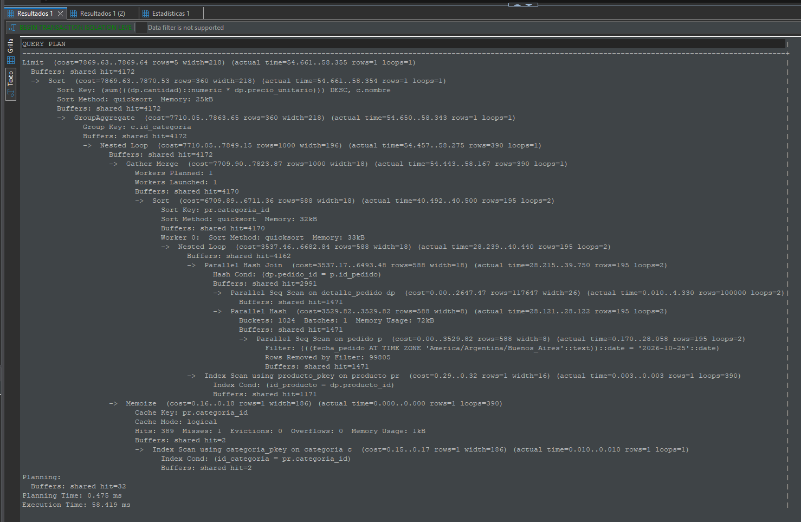
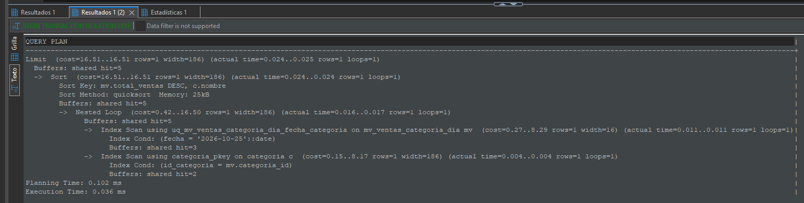

# TP6 — Forma Normal de Boyce-Codd y Desnormalización Controlada

Este informe refleja el estado final del TP6. Los entregables canónicos son `db/tp_fnbc_control_lote.sql` para la Parte 1 y `db/tp_desnormalizacion_top_categorias.sql` para la Parte 2.

## 4.2 — Análisis de dependencias funcionales

### a) Dependencias funcionales

De las dos reglas de negocio relevadas se desprenden las siguientes dependencias funcionales no triviales:

- **DF1:** `{LoteID, DepositoID} → ResponsableControlID`

  Para un lote y un depósito dados, el responsable de control queda unívocamente determinado.

- **DF2:** `ResponsableControlID → DepositoID`

  Cada responsable de control pertenece a un único depósito.

DF1 es la dependencia que modela la clave primaria declarada de la relación. DF2 es la dependencia funcional que provoca la violación de FNBC, porque su determinante, `ResponsableControlID`, no es una superclave de la relación original.

No se postulan `LoteID → DepositoID` ni `LoteID → ResponsableControlID`, ya que la consigna permite que un lote sea controlado desde varios depósitos y por distintos responsables.


### b) Clausuras y claves candidatas

**Universo de atributos:**

\(U = \{L, D, R\}\), donde:
- \(L\): LoteID
- \(D\): DepositoID
- \(R\): ResponsableControlID

**Clausuras relevantes:**

- \(L^{+} = \{L\}\)
- \(D^{+} = \{D\}\)
- \(R^{+} = \{R, D\}\)
- \((LD)^{+} = \{L, D, R\}\)
- \((LR)^{+} = \{L, R, D\}\)
- \((DR)^{+} = \{D, R\}\)

**Claves candidatas:**

\(\{L,D\}\) es superclave porque \((LD)^{+} = U\). Es mínima porque \(L^{+} = \{L\}\) y \(D^{+} = \{D\}\) no cubren \(U\). Por lo tanto, es clave candidata.

\(\{L,R\}\) es superclave porque \((LR)^{+} = U\). Es mínima porque \(L^{+} = \{L\}\) y \(R^{+} = \{R,D\}\) no cubren \(U\). Por lo tanto, es clave candidata.

**Conjunto completo de claves candidatas:**

\[
K = \{\{L,D\}, \{L,R\}\}
\]

No existen otras claves candidatas. Toda clave debe contener \(L\), porque ninguna dependencia funcional permite derivar \(L\) a partir de otros atributos. Además, debe incluir al menos \(D\) o \(R\) para determinar todos los atributos; \(\{L\}\) por sí solo no alcanza, y \(\{L,D,R\}\) no es mínima porque contiene a \(\{L,D\}\). Por eso, las únicas claves candidatas son \(\{L,D\}\) y \(\{L,R\}\).

**Atributos primos y no primos:**

Un atributo es primo si pertenece al menos a una clave candidata.

- **Atributos primos:** LoteID, DepositoID y ResponsableControlID.
- **Atributos no primos:** ninguno.


### c) Verificación de la Forma Normal de Boyce-Codd (FNBC)

**Definición formal:** Un esquema relacional \(S\) está en FNBC si y solo si, para toda dependencia funcional no trivial \(X \rightarrow Y\) que se cumple en \(S\), \(X\) es una superclave de \(S\).

Las dependencias funcionales no triviales del esquema son:

| Dependencia funcional | Determinante | ¿Es superclave? |
|---|---|---|
| \(\{L,D\} \rightarrow R\) | \(\{L,D\}\) | Sí, porque \((LD)^{+} = U\). |
| \(R \rightarrow D\) | \(\{R\}\) | No, porque \(R^{+} = \{R,D\}\) y no contiene \(L\). |

Por lo tanto, la relación `control_lote_almacen` **no cumple con la FNBC**.

La dependencia funcional violatoria es:

**`ResponsableControlID → DepositoID`**

Su determinante, `ResponsableControlID`, no es una superclave: conocer el responsable permite determinar su depósito, pero no permite determinar el lote. Formalmente, \(R^{+} = \{R,D\}\), que no incluye \(L\), por lo que no determina todos los atributos de la relación.

Aunque esta dependencia funcional se cumple por una regla de negocio, su determinante no es una superclave de la relación, por lo que viola la definición formal de FNBC.


### d) Anomalías sobre la instancia de ejemplo

La instancia de referencia de la relación `control_lote_almacen` es:

| lote_id | deposito_id | responsable_control_id |
|---:|---:|---:|
| 501 | 30 | 801 |
| 502 | 30 | 801 |
| 503 | 31 | 802 |

Las tres anomalías son manifestaciones de la dependencia funcional violatoria `ResponsableControlID → DepositoID`, que no está impuesta por el esquema: la clave primaria es `(LoteID, DepositoID)` y no existe una restricción que garantice que cada responsable se asocie a un único depósito.

**Anomalía de inserción**

Supongamos que se contrata al responsable 803 y se lo asigna al depósito 32, pero todavía no tiene lotes asignados. No se puede registrar esa pertenencia en `control_lote_almacen` porque toda fila requiere un `lote_id` válido y no nulo, y ese atributo forma parte de la clave primaria. La dependencia funcional `ResponsableControlID → DepositoID` no impide por sí sola la inserción; la imposibilidad surge de la estructura de la relación, que obliga a asociar cada pertenencia responsable-depósito con un lote concreto. Para registrar el hecho `803 → 32` habría que inventar un `lote_id` ficticio, lo que introduciría un dato inexistente.

**Anomalía de borrado**

Si el lote 503 es el único lote en el que intervino el depósito 31, borrar la fila `(503, 31, 802)` para eliminar ese control implica también eliminar el único registro que evidencia que el responsable 802 pertenece al depósito 31. Como la relación solo almacena la pertenencia `802 → 31` a través de una fila asociada a un lote, se pierde información de la DF `ResponsableControlID → DepositoID` como efecto colateral de eliminar un hecho operativo.

**Anomalía de actualización**

El responsable 801 aparece en dos filas, correspondientes a los lotes 501 y 502, ambos del depósito 30. Si el responsable 801 es transferido al depósito 33, es necesario actualizar `deposito_id` a 33 en ambas filas. Si por error o concurrencia solo se actualiza una de ellas, la base de datos queda en un estado inconsistente: el mismo responsable aparece asociado a dos depósitos distintos, violando la DF `ResponsableControlID → DepositoID`. El esquema no impide este estado, porque no tiene una restricción que fuerce `ResponsableControlID → DepositoID`.


### e) Descomposición sin pérdida

Se aplica la descomposición a partir de la dependencia funcional violatoria:

`responsable_control_id → deposito_id`

La relación original `control_lote_almacen(lote_id, deposito_id, responsable_control_id)` se descompone en dos relaciones:

- **R1: `responsable_deposito(responsable_control_id, deposito_id)`.** Almacena la pertenencia de cada responsable a un único depósito. La clave primaria es `responsable_control_id`, que garantiza la dependencia funcional `responsable_control_id → deposito_id`.

- **R2: `control_lote(lote_id, responsable_control_id)`.** Registra qué responsable controla cada lote. Su clave primaria compuesta es `(lote_id, responsable_control_id)`.

Para que el ejercicio sea autocontenido y reproducible, el script `db/tp_fnbc_control_lote.sql` materializa la relación original `control_lote_almacen` con su instancia de ejemplo, crea las tablas maestras mínimas `usuario(id_usuario)`, `deposito(id_deposito)` y `lote(id_lote)`, migra la instancia a `responsable_deposito` y `control_lote`, y define la vista de compatibilidad. Estas tablas no forman parte del esquema original de Food Store: son una extensión mínima del ejercicio que permite declarar las claves foráneas sin modificar `db/schema.sql`.

**Claves primarias y foráneas**

| Tabla | Clave primaria | Claves foráneas |
|---|---|---|
| `usuario` | `id_usuario` | — |
| `deposito` | `id_deposito` | — |
| `lote` | `id_lote` | — |
| `responsable_deposito` | `responsable_control_id` | `responsable_control_id → usuario(id_usuario)`; `deposito_id → deposito(id_deposito)` |
| `control_lote` | `(lote_id, responsable_control_id)` | `lote_id → lote(id_lote)`; `responsable_control_id → responsable_deposito(responsable_control_id)` |

Las cuatro claves foráneas se declaran con `ON DELETE RESTRICT`. La FK de `control_lote` hacia `responsable_deposito` asegura que todo responsable que controla un lote tenga una pertenencia válida a un depósito. Las FK hacia `usuario`, `deposito` y `lote` aseguran que los identificadores referenciados existan en las tablas maestras.

La vista de compatibilidad `v_control_lote_almacen` reconstruye la relación original:

```sql
CREATE VIEW v_control_lote_almacen AS
SELECT
    cl.lote_id,
    rd.deposito_id,
    cl.responsable_control_id
FROM control_lote AS cl
JOIN responsable_deposito AS rd
    USING (responsable_control_id);
```

Como `responsable_control_id` es clave primaria de `responsable_deposito`, cada fila de `control_lote` se asocia con un único depósito. La descomposición es sin pérdida porque la intersección de R1 y R2 es `{responsable_control_id}`, que es clave de R1. Además, la FK de `control_lote` hacia `responsable_deposito` garantiza que toda fila de R2 tenga su fila correspondiente en R1, por lo que el `JOIN` interno no pierde filas de R2. Las filas de R1 que no tienen ningún lote no aparecen en la vista, pero eso es correcto: no forman parte de la relación original.

R1 y R2 quedan en FNBC. En R1, la única dependencia funcional no trivial es `responsable_control_id → deposito_id`, cuyo determinante es la clave. R2 no tiene dependencias funcionales no triviales.

#### Preservación de dependencias funcionales

La dependencia `responsable_control_id → deposito_id` queda preservada por la clave primaria de `responsable_deposito`.

En cambio, la dependencia `(lote_id, deposito_id) → responsable_control_id` no queda garantizada automáticamente por las claves primarias ni por las claves foráneas del esquema descompuesto. Las FK hacia `usuario`, `deposito` y `lote` no impiden que un mismo par `(lote_id, deposito_id)` se asocie a más de un responsable.

Contraejemplo mínimo:

```text
responsable_deposito: (r1, d1), (r2, d1)
control_lote:         (l1, r1), (l1, r2)
```

Ambas tablas satisfacen sus claves, pero la vista devuelve:

```text
(l1, d1, r1)
(l1, d1, r2)
```

El mismo par `(l1, d1)` aparece asociado a dos responsables distintos, lo que viola `(lote_id, deposito_id) → responsable_control_id`.

La consulta de diagnóstico incluida como comentario al final de `db/tp_fnbc_control_lote.sql` permite detectar estos casos: agrupa por `(lote_id, deposito_id)` y muestra los pares con más de un `responsable_control_id`. La consulta solo detecta la violación; no la impide ni corrige los datos.

Por lo tanto, la descomposición no preserva todas las dependencias funcionales: DF2 se conserva, pero DF1 no queda garantizada por las restricciones del esquema descompuesto.

### f) Justificación de sin pérdida y migración de datos

#### Criterio de Heath

La descomposición de `control_lote_almacen(lote_id, deposito_id, responsable_control_id)` en:

- `R1 = responsable_deposito(responsable_control_id, deposito_id)`
- `R2 = control_lote(lote_id, responsable_control_id)`

es sin pérdida por el criterio de Heath. La unión de los atributos de ambas relaciones reconstruye el esquema original:

`R1 ∪ R2 = {responsable_control_id, deposito_id} ∪ {lote_id, responsable_control_id} = {lote_id, deposito_id, responsable_control_id}`

La intersección de ambas relaciones es:

`R1 ∩ R2 = {responsable_control_id}`

Además, se cumple `responsable_control_id → deposito_id`, por lo que:

`{responsable_control_id} → {responsable_control_id, deposito_id} = R1`

Es decir, el atributo común es superclave de `responsable_deposito`. Por el criterio de Heath, la reunión natural por `responsable_control_id` recupera exactamente la relación original y no genera tuplas espurias.

La FK de `control_lote` hacia `responsable_deposito` no es la que demuestra la propiedad de sin pérdida; solo garantiza que toda fila de `control_lote` tenga un responsable-depósito válido para la reunión. La descomposición es sin pérdida, pero no preserva todas las dependencias funcionales: `responsable_control_id → deposito_id` se conserva por la clave primaria de `responsable_deposito`; `(lote_id, deposito_id) → responsable_control_id` no queda garantizada por las restricciones y puede violarse en la vista.

#### Migración de datos de ejemplo

La versión final de la migración está en `db/tp_fnbc_control_lote.sql`. Primero materializa la instancia original en `control_lote_almacen` y luego deriva las tablas maestras y las relaciones descompuestas mediante `INSERT ... SELECT`, sin repetir los literales por separado.

```sql
INSERT INTO usuario (id_usuario)
OVERRIDING SYSTEM VALUE
SELECT DISTINCT responsable_control_id
FROM control_lote_almacen;

INSERT INTO deposito (id_deposito)
OVERRIDING SYSTEM VALUE
SELECT DISTINCT deposito_id
FROM control_lote_almacen;

INSERT INTO lote (id_lote)
OVERRIDING SYSTEM VALUE
SELECT DISTINCT lote_id
FROM control_lote_almacen;

INSERT INTO responsable_deposito (responsable_control_id, deposito_id)
SELECT DISTINCT
    responsable_control_id,
    deposito_id
FROM control_lote_almacen;

INSERT INTO control_lote (lote_id, responsable_control_id)
SELECT
    lote_id,
    responsable_control_id
FROM control_lote_almacen;
```

Las claves primarias de `usuario`, `deposito` y `lote` son `GENERATED ALWAYS AS IDENTITY`, por lo que los IDs explícitos requieren `OVERRIDING SYSTEM VALUE`. El orden respeta las claves foráneas: primero se cargan `usuario`, `deposito` y `lote`; después `responsable_deposito`; por último `control_lote`. La migración se ejecuta dentro de una transacción y las verificaciones de la Sección 7 del script comparan el origen con la vista mediante `EXCEPT` en ambas direcciones.

#### Verificación

La consulta de verificación utilizada para comprobar la reconstrucción es:

```sql
SELECT lote_id, deposito_id, responsable_control_id
FROM v_control_lote_almacen
ORDER BY lote_id, responsable_control_id;
```

El resultado verificado en `bd2_tp6` fue:

```text
 lote_id | deposito_id | responsable_control_id
---------+-------------+------------------------
     501 |          30 |                    801
     502 |          30 |                    801
     503 |          31 |                    802
```

La migración y la reconstrucción fueron verificadas. Los conteos obtenidos coinciden con los esperados:

| Conjunto | Filas |
|---|---:|
| `control_lote` (R2) | 3 |
| `control_lote_almacen` | 3 |
| `responsable_deposito` (R1) | 2 |
| `v_control_lote_almacen` | 3 |

Las comparaciones de conjuntos entre `control_lote_almacen` y `v_control_lote_almacen` devolvieron **0 diferencias** en ambas direcciones.

#### Anomalías después de la descomposición

- **Inserción:** ahora se puede registrar un responsable en un depósito sin lote insertando en `responsable_deposito`, siempre que existan el usuario y el depósito referenciados. La anomalía original queda resuelta. La vista no muestra esa asignación hasta que exista una fila en `control_lote`; para verificarla debe consultarse `responsable_deposito`.
- **Borrado:** borrar una fila de `control_lote` ya no elimina la pertenencia responsable-depósito, que permanece en `responsable_deposito`. La anomalía original queda resuelta. Si se intenta borrar una fila de `responsable_deposito` referenciada por `control_lote`, la FK con `ON DELETE RESTRICT` lo impide.
- **Actualización:** cambiar el depósito de un responsable requiere actualizar una sola fila en `responsable_deposito`; la clave primaria `responsable_control_id` impide que el mismo responsable quede asociado a dos depósitos. La anomalía original queda resuelta.
- **Limitación residual:** la dependencia `(lote_id, deposito_id) → responsable_control_id` no queda garantizada por las restricciones de la descomposición. Por lo tanto, la vista puede mostrar un mismo par `(lote_id, deposito_id)` con más de un responsable. La consulta de diagnóstico detecta esa situación, pero no la impide. La descomposición elimina las anomalías asociadas a `responsable_control_id → deposito_id`, pero no garantiza la DF `(lote_id, deposito_id) → responsable_control_id`.


### 5.2 a) Consulta original y medición

La consulta original medida en 5.2(a), adaptada a los nombres de columnas de `db/schema.sql`, es:

```sql
SELECT
    c.nombre AS categoria,
    SUM(dp.cantidad * dp.precio_unitario) AS total_ventas
FROM pedido AS p
JOIN detalle_pedido AS dp
    ON dp.pedido_id = p.id_pedido
JOIN producto AS pr
    ON pr.id_producto = dp.producto_id
JOIN categoria AS c
    ON c.id_categoria = pr.categoria_id
WHERE (p.fecha_pedido AT TIME ZONE 'America/Argentina/Buenos_Aires')::date = DATE '2026-10-25'
GROUP BY c.nombre
ORDER BY total_ventas DESC
LIMIT 5;
```

Se ejecutó con `EXPLAIN (ANALYZE, BUFFERS)` sobre la base `bd2_tp6`. La fecha utilizada en la comparación fue **2026-10-25**, fijada de forma explícita para que la medición sea reproducible.

Resumen de la medición:

| Métrica | Consulta original 5.2(a) |
|---|---:|
| Planning Time | 0,475 ms |
| Execution Time | 58,419 ms |
| Buffers | `shared hit=4172` |

<figure style="margin: 0; page-break-inside: avoid; break-inside: avoid;">
  
  <figcaption style="margin-top: 0.35em; text-align: left;"><em>Figura 1. EXPLAIN ANALYZE de la consulta original 5.2(a) sobre las tablas base. Planning Time 0,475 ms; Execution Time 58,419 ms; shared hit=4172.</em></figcaption>
</figure>

La consulta recorre `pedido`, `detalle_pedido`, `producto` y `categoria`, y calcula la agregación de ventas por categoría en cada ejecución. La medición corresponde a una única ejecución: no es un promedio y los tiempos y buffers dependen del entorno, del plan elegido y del estado de caché.

### 5.2 b) Elección del patrón de desnormalización controlada

Se elige una vista materializada porque la consulta original necesita recorrer las tablas de pedidos y detalles y recalcular la agregación en cada ejecución. La vista materializada almacena el dato derivado `total_ventas` por fecha local y categoría; de este modo, el panel lee un resultado ya agregado y no vuelve a recorrer ni a unir las tablas base para cada consulta.

La alternativa de mantener una columna `subtotal` con un disparador solo evitaría recalcular la multiplicación `cantidad * precio_unitario`, pero no eliminaría el recorrido de pedidos, detalles y productos ni la agregación por categoría. La vista materializada ataca directamente esa parte del costo.

Las tablas base siguen siendo la fuente de verdad: `total_ventas` es un atributo redundante y derivado, controlado mediante refrescos. La solución es reversible sin pérdida de información original, porque la vista y su índice pueden eliminarse y reconstruirse a partir de las tablas base.

### 5.2 c) Estructura y mecanismo de actualización

La estructura definida en `db/tp_desnormalizacion_top_categorias.sql` es:

```sql
CREATE MATERIALIZED VIEW IF NOT EXISTS mv_ventas_categoria_dia AS
SELECT
    (p.fecha_pedido AT TIME ZONE 'America/Argentina/Buenos_Aires')::date AS fecha,
    pr.categoria_id,
    SUM(dp.cantidad * dp.precio_unitario) AS total_ventas
FROM pedido AS p
JOIN detalle_pedido AS dp
    ON dp.pedido_id = p.id_pedido
JOIN producto AS pr
    ON pr.id_producto = dp.producto_id
GROUP BY
    (p.fecha_pedido AT TIME ZONE 'America/Argentina/Buenos_Aires')::date,
    pr.categoria_id
WITH DATA;

CREATE UNIQUE INDEX IF NOT EXISTS uq_mv_ventas_categoria_dia_fecha_categoria
    ON mv_ventas_categoria_dia (fecha, categoria_id);
```

El mecanismo de actualización es `REFRESH MATERIALIZED VIEW CONCURRENTLY public.mv_ventas_categoria_dia`. Para funcionar requiere que la vista esté poblada, que exista un índice único válido sobre `(fecha, categoria_id)` y que el refresco no se ejecute dentro de un bloque de transacción explícito. El modo concurrente permite lecturas mientras se actualiza, pero hace más trabajo y no es incremental: cada refresco vuelve a agregar todo el histórico.

Si la vista está vacía o fue creada `WITH NO DATA`, debe usarse primero `REFRESH MATERIALIZED VIEW public.mv_ventas_categoria_dia`, que recalcula todo y bloquea las lecturas mientras dura. PostgreSQL estándar no incluye un planificador nativo de refrescos, por lo que la frecuencia debe definirse con una herramienta externa (por ejemplo, el Programador de tareas de Windows, cron o `pg_cron`) o ejecutarse manualmente.

El script define la estructura, el índice y las verificaciones previas, pero no programa ni ejecuta el refresco. Entre un refresco y el siguiente, las ventas nuevas o modificadas no se reflejan en la vista: el panel puede mostrar datos desactualizados.

### 5.2 d) Consulta desnormalizada y comparación

La consulta desnormalizada dinámica que contiene el script oficial `db/tp_desnormalizacion_top_categorias.sql` es:

```sql
SELECT
    c.nombre AS categoria,
    mv.total_ventas
FROM mv_ventas_categoria_dia AS mv
JOIN categoria AS c
    ON c.id_categoria = mv.categoria_id
WHERE mv.fecha = (CURRENT_TIMESTAMP AT TIME ZONE 'America/Argentina/Buenos_Aires')::date
ORDER BY mv.total_ventas DESC, c.nombre
LIMIT 5;
```

Para la medición comparativa se usó la versión con fecha fija:

```sql
SELECT
    c.nombre AS categoria,
    mv.total_ventas
FROM mv_ventas_categoria_dia AS mv
JOIN categoria AS c
    ON c.id_categoria = mv.categoria_id
WHERE mv.fecha = DATE '2026-10-25'
ORDER BY mv.total_ventas DESC, c.nombre
LIMIT 5;
```

La comparación se realizó con fecha **2026-10-25**. La versión dinámica del script usa el día actual al reejecutarse; la versión medida fija la fecha para comparar contra la consulta original medida. La siguiente tabla resume las mediciones verificadas con `EXPLAIN (ANALYZE, BUFFERS)` sobre `bd2_tp6`:

| Métrica | Consulta original 5.2(a) | Vista materializada 5.2(d) |
|---|---:|---:|
| Planning Time | 0,475 ms | 0,102 ms |
| Execution Time | 58,419 ms | 0,036 ms |
| Buffers | `shared hit=4172` | `shared hit=5` |



*Figura 2. EXPLAIN ANALYZE de la consulta 5.2(d) sobre la vista materializada `mv_ventas_categoria_dia`. Planning Time 0,102 ms; Execution Time 0,036 ms; shared hit=5.*

La diferencia se explica porque la vista ya contiene los totales agregados por fecha y categoría y el índice único permite localizar el día; la consulta no recorre ni agrega las tablas base. El menor número de buffers es consistente con ese acceso más acotado.

Estas son mediciones de una sola ejecución, no un promedio ni un benchmark. Los tiempos y la cantidad de buffers dependen del entorno, del plan elegido, del volumen de datos y del estado de caché. La mejora no elimina el costo de mantenimiento: la vista debe refrescarse y, entre refrescos, puede quedar desactualizada.

### 5.2 e) Auditoría de sincronización de la vista materializada

El objetivo de la auditoría es comprobar que el atributo redundante `total_ventas` de `mv_ventas_categoria_dia` coincida, para todo el histórico, con los importes recalculados desde las tablas originales. La fuente de verdad sigue siendo la reunión de `pedido`, `detalle_pedido` y `producto`, sobre la que se aplica `SUM(dp.cantidad * dp.precio_unitario)` agrupado por fecha local y categoría.

La auditoría se implementó en `db/tp_desnormalizacion_top_categorias.sql` (Secciones 5 y 6) y se ejecutó sobre la base `bd2_tp6`. Es de solo lectura: no crea, modifica ni refresca objetos ni datos. Para recalcular los totales utiliza la misma expresión de fecha y zona horaria que la vista materializada, `(p.fecha_pedido AT TIME ZONE 'America/Argentina/Buenos_Aires')::date`, y compara con la vista mediante un `FULL OUTER JOIN` sobre `(fecha, categoria_id)`. Detecta tres clases de discrepancia: combinaciones presentes en las tablas originales pero faltantes en la vista (`FALTA_EN_VISTA`), combinaciones presentes en la vista pero sin respaldo actual en las tablas originales (`SOBRA_EN_VISTA`) e importes distintos para una misma combinación (`IMPORTE_DISTINTO`).

Resultados verificados de la ejecución:

| Control | Resultado |
|---|---:|
| Grupos en las tablas originales (`grupos_base`) | 366 |
| Grupos en la vista materializada (`grupos_vista`) | 366 |
| Discrepancias | 0 |
| Estado del control | `SIN_DISCREPANCIAS` |
| Duplicados para `(fecha, categoria_id)` | 0 |
| Filas materializadas | 366 |
| Primera fecha materializada | 2025-10-25 |
| Última fecha materializada | 2026-10-25 |

La consulta principal de auditoría no devolvió filas, es decir, no se detectaron combinaciones faltantes ni sobrantes ni diferencias de importe. El control de ejecución devolvió 366 grupos en las tablas originales, 366 grupos en la vista y 0 discrepancias. El diagnóstico de duplicados devolvió 0 filas y el conteo de la vista devolvió 366 filas materializadas en el rango 2025-10-25 a 2026-10-25.

La auditoría compara el estado actual de las tablas base con el estado actual de la vista; no reconstruye la historia. Si cambia `producto.categoria_id`, el recálculo imputa las ventas históricas a la categoría actual y un refresco posterior reatribuye esas ventas sin dejar rastro. Por eso la auditoría no detecta por sí sola las reatribuciones históricas causadas por cambios de categoría.

Cabe aclarar que la vista puede quedar desactualizada después de cambios en `pedido`, `detalle_pedido` o `producto` hasta que se ejecute un refresco. Los resultados corresponden al estado de la base en el instante de la auditoría y no reemplazan al `REFRESH MATERIALIZED VIEW` programado.
