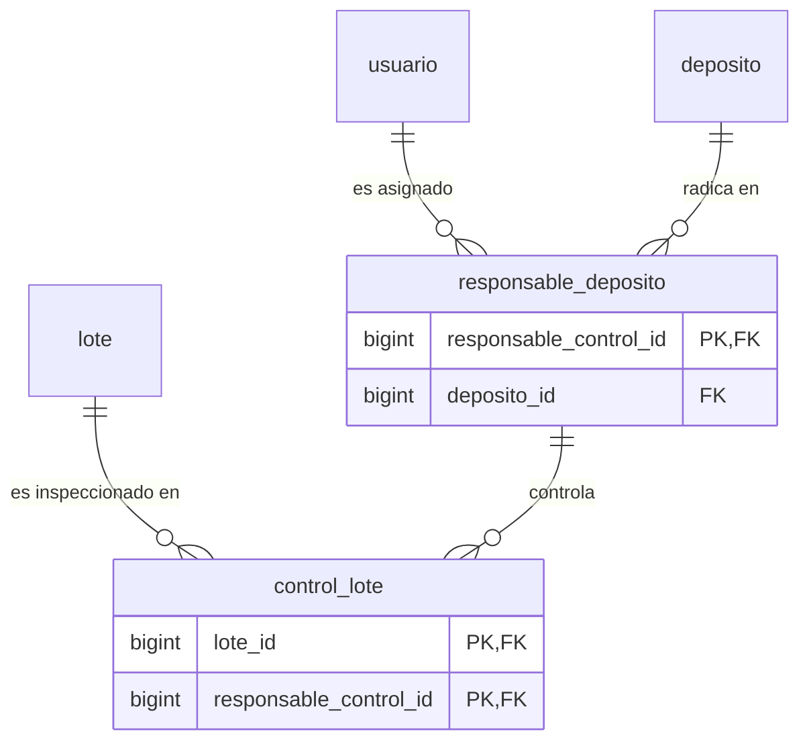

# Especificación Kiro — Diseño Técnico y Formalización Matemática (Unidad 4)
## Asignatura: Base de Datos II · Tecnicatura Universitaria en Programación (UTN)
### Proyecto Integrador: Food Store · Módulo: Normalización FNBC y Desnormalización

---

## 1. Formalización Teórica de la Descomposición FNBC

### 1.1. Universo de Atributos y Dependencias Funcionales Reales
Sea el esquema heredado:
$$S = \text{control\_lote\_almacen}(L, D, R)$$
donde:
* $L = \text{lote\_id}$
* $D = \text{deposito\_id}$
* $R = \text{responsable\_control\_id}$

El conjunto de dependencias funcionales mínimas y no triviales relevadas de las reglas de negocio es:
$$F = \{ \text{DF1}: \{L, D\} \rightarrow R, \quad \text{DF2}: R \rightarrow D \}$$

### 1.2. Clausuras y Claves Candidatas
Calculamos las clausuras de atributos sobre $F$:
* $L^+ = \{L\}$
* $D^+ = \{D\}$
* $R^+ = \{R, D\}$
* $(LD)^+ = \{L, D, R\} = U$  $\implies \{L, D\}$ es superclave mínima (Clave Candidata 1).
* $(LR)^+ = \{L, R, D\} = U$  $\implies \{L, R\}$ es superclave mínima (Clave Candidata 2).
* $(DR)^+ = \{D, R\}$

**Conjunto de Claves Candidatas:** $K = \{ \{L, D\}, \{L, R\} \}$.  
**Atributos primos:** $\{L, D, R\}$ (todos pertenecen a al menos una clave candidata).  
**Atributos no primos:** $\emptyset$.  
El esquema está en Tercera Forma Normal (3FN) porque en toda DF no trivial, o el determinante es superclave o el dependiente es primo.

### 1.3. Demostración de la Violación de FNBC
**Definición de FNBC:** Un esquema relacional $S$ está en Forma Normal de Boyce-Codd si y solo si, para toda dependencia funcional no trivial $X \rightarrow Y \in F^+$, $X$ es una superclave de $S$.

Evaluación sobre $F$:
1. $\{L, D\} \rightarrow R$: $\{L, D\}$ es superclave $\implies$ **Cumple FNBC**.
2. $R \rightarrow D$: $R^+ = \{R, D\} \neq U$. El determinante $\{R\}$ **NO es superclave** de la relación $\implies$ **VIOLA FNBC**.

### 1.4. Algoritmo de Descomposición y Criterio de Heath
Dado que $R \rightarrow D$ viola FNBC, se descompone la relación original en dos sub-relaciones:
1. $R_1(R, D) = \text{responsable\_deposito}(\underline{\text{responsable\_control\_id}}, \text{deposito\_id})$
   * Dependencia funcional proyectada: $R \rightarrow D$.
   * Clave primaria: $R$ (Determinante es clave $\implies$ Cumple FNBC).
2. $R_2(L, R) = \text{control\_lote}(\underline{\text{lote\_id}, \text{responsable\_control\_id}})$
   * Dependencias funcionales no triviales: $\emptyset$.
   * Clave primaria: $(L, R)$ $\implies$ Cumple FNBC trivialmente.

**Demostración de Descomposición sin Pérdida (Criterio de Heath):**
Una descomposición de $S$ en $(R_1, R_2)$ es sin pérdida si y solo si:
$$(R_1 \cap R_2) \rightarrow (R_1 - R_2) \quad \text{ó} \quad (R_1 \cap R_2) \rightarrow (R_2 - R_1)$$
En nuestra descomposición:
* $R_1 \cap R_2 = \{R\} = \{\text{responsable\_control\_id}\}$
* $R_1 - R_2 = \{D\} = \{\text{deposito\_id}\}$
* Se cumple la dependencia funcional $R \rightarrow D$.

Por lo tanto, la reunión natural $R_1 \bowtie R_2$ garantiza la reconstrucción fiel y exacta de las tuplas originales sin generar tuplas espurias ni perder registros.

**Análisis de Preservación de Dependencias:**
* $R \rightarrow D$ se preserva directamente en $R_1$.
* $\{L, D\} \rightarrow R$ no se preserva mediante claves en el esquema descompuesto (requiere validación mediante vista o consulta de diagnóstico de pares $(L, D)$ con múltiples responsables).

---

## 2. Diseño de Tablas y Vista de Compatibilidad



### Vista de Compatibilidad:
```sql
CREATE OR REPLACE VIEW v_control_lote_almacen AS
SELECT
    cl.lote_id,
    rd.deposito_id,
    cl.responsable_control_id
FROM control_lote AS cl
JOIN responsable_deposito AS rd
    USING (responsable_control_id);
```

---

## 3. Diseño de la Desnormalización Controlada (Panel de Ventas)

### 3.1. Vista Materializada e Índice Único
```sql
CREATE MATERIALIZED VIEW IF NOT EXISTS mv_ventas_categoria_dia AS
SELECT
    (p.fecha_pedido AT TIME ZONE 'America/Argentina/Buenos_Aires')::date AS fecha,
    pr.categoria_id,
    SUM(dp.cantidad * dp.precio_unitario) AS total_ventas
FROM pedido AS p
JOIN detalle_pedido AS dp ON dp.pedido_id = p.id_pedido
JOIN producto AS pr ON pr.id_producto = dp.producto_id
GROUP BY
    (p.fecha_pedido AT TIME ZONE 'America/Argentina/Buenos_Aires')::date,
    pr.categoria_id
WITH DATA;

CREATE UNIQUE INDEX IF NOT EXISTS uq_mv_ventas_categoria_dia_fecha_categoria
    ON mv_ventas_categoria_dia (fecha, categoria_id);
```

### 3.2. Consulta de Auditoría con FULL OUTER JOIN
Permite comparar las cifras consolidadas contra el recálculo dinámico directo de la fuente de verdad:
```sql
WITH base_calculada AS (
    SELECT
        (p.fecha_pedido AT TIME ZONE 'America/Argentina/Buenos_Aires')::date AS fecha,
        pr.categoria_id,
        SUM(dp.cantidad * dp.precio_unitario) AS total_ventas_base
    FROM pedido p
    JOIN detalle_pedido dp ON dp.pedido_id = p.id_pedido
    JOIN producto pr ON pr.id_producto = dp.producto_id
    GROUP BY 1, 2
)
SELECT 
    COALESCE(b.fecha, mv.fecha) AS fecha,
    COALESCE(b.categoria_id, mv.categoria_id) AS categoria_id,
    b.total_ventas_base,
    mv.total_ventas AS total_ventas_vista,
    CASE 
        WHEN mv.fecha IS NULL THEN 'FALTA_EN_VISTA'
        WHEN b.fecha IS NULL THEN 'SOBRA_EN_VISTA'
        WHEN b.total_ventas_base <> mv.total_ventas THEN 'IMPORTE_DISTINTO'
        ELSE 'SIN_DISCREPANCIAS'
    END AS estado_control
FROM base_calculada b
FULL OUTER JOIN mv_ventas_categoria_dia mv
    ON b.fecha = mv.fecha AND b.categoria_id = mv.categoria_id
WHERE b.total_ventas_base IS DISTINCT FROM mv.total_ventas;
```
