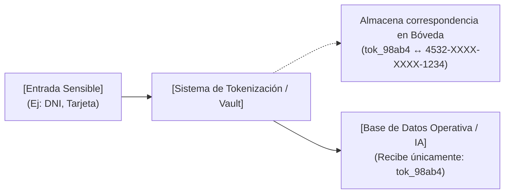

**TECNICATURA UNIVERSITARIA EN PROGRAMACIÓN BASE DE DATOS II** 

**UNIDAD 5 · CLASE 2 de 2** 

# **Texto Complementario** 

### _Función Hash-Salt y Tokenización_ 

|**Asignatura**|Base de Datos II, Unidad 5: Administración y Seguridad|
|---|---|
|**Ubicación**|Semana 9 de la cursada, Clase 2 de 2|
|**Requisito previo**|Clase 1: esquema de roles y permisos de Food Store (roles.sql)|
|**Motor**|PostgreSQL 16 o superior|
|**Meta de la clase**|Reconocer y mitigar las tres amenazas centrales sobre una base relacional, y<br>aplicar los principios de protección de datos personales al proyecto|
|**Ciclo lectivo**|2026|


En el contexto de la seguridad de bases de datos y la protección de datos personales, el **hashing con sal** ( _salt_ ) es una técnica criptográfica unidireccional e irreversible utilizada principalmente para el almacenamiento seguro de credenciales (como contraseñas). 

#### **1. ¿Cómo funciona?** 

- **Función Hash (unidireccional):** A partir del valor de entrada se genera una síntesis criptográfica fija e irreversible mediante un algoritmo robusto (por ejemplo, Blowfish con bf o Argon2). Esto implica que ni siquiera el propio sistema puede desencriptar o recuperar la contraseña original; solo puede recalcular el hash cuando el usuario intenta iniciar sesión y comparar ambos resúmenes. 

- **La Sal (** **_Salt_ ):** Consiste en un fragmento de datos aleatorio y único que se concatena al texto plano antes de aplicar la función de hashing. 

- **El almacenamiento:** El resultado generado (que habitualmente almacena tanto la sal como el hash resultante juntos en una columna de credencial) asegura que contraseñas idénticas produzcan hashes completamente diferentes en la base de datos, evitando que dos usuarios con la misma clave tengan el mismo registro. 

#### **2. ¿Para qué se utiliza?** 

- **Almacenamiento seguro de credenciales:** Evita guardar o comparar contraseñas en texto plano. 

- **Protección contra ataques por diccionario y tablas arcoíris (** **_rainbow tables_ ):** Al agregar una sal aleatoria previa al cálculo del hash, un atacante no puede comparar los valores robados contra listas precomputadas de hashes de contraseñas habituales. 

Página **1** de **6** 

#### **3. Ejemplo práctico en PostgreSQL (** pgcrypto **)** 

En el material de la cátedra se implementa mediante la extensión pgcrypto: 

- **Al registrar o resetear una contraseña (se genera la sal):** 

#### **UPDATE** usuario 

**SET** contrasena = **crypt** (p_nueva, gen_salt('bf')) **WHERE** id = p_usuario_id; 

_Aquí gen_salt('bf') genera una sal aleatoria utilizando el algoritmo Blowfish._ 

- **Al autenticar al usuario (se reutiliza la sal guardada):** 

**SELECT** u.id, u.rol **FROM** usuario u 

**WHERE** u.mail = p_mail **AND** u.contrasena = **crypt** (p_pass, u.contrasena); 

La función _crypt(p_pass, u.contrasena)_ extrae automáticamente la sal ya almacenada dentro del campo u.contrasena, recalcula el hash de la clave ingresada (p_pass) con esa sal y compara los hashes. La contraseña real nunca se expone ni se compara en texto claro. 

Las referencias bibliográficas 

- Grupo de Trabajo del Artículo 29. (2014). _Opinion 05/2014 on anonymisation techniques_ (WP216) [Documento de trabajo de acceso abierto]. Comisión Europea. https://ec.europa.eu/justice/article- <u>29/documentation/opinion-recommendation/files/2014/wp216_en.pdf</u> 

- Ley 25.326 de Protección de los Datos Personales. (2000). _Boletín Oficial de la República Argentina_ [Normativa legal de dominio público]. <u>https://www.argentina.gob.ar/normativa/nacional/64790/texto</u> 

- McCallister, E., Grance, T. y Scarfone, K. (2010). _Guide to protecting the confidentiality of personally identifiable information (PII)_ (NIST Special Publication 800-122) [Publicación del gobierno de EE. UU. / Dominio público]. National Institute of Standards and Technology. <u>https://doi.org/10.6028/NIST.SP.800-122</u> 

- OWASP Foundation. (s.f.). _Authentication cheat sheet_ [Documentación técnica abierta bajo licencia Creative Commons Attribution-ShareAlike 4.0 (CC BY-SA 4.0)]. OWASP Cheat Sheet Series. <u>https://cheatsheetseries.owasp.org/cheatsheets/Authentication_Cheat_Sheet.html</u> 

- PostgreSQL Global Development Group. (2023). _pgcrypto_ [Documentación de software libre bajo la Licencia PostgreSQL / Open Source]. PostgreSQL 16 documentation. <u>https://www.postgresql.org/docs/16/pgcrypto.html</u> 

Página **2** de **6** 

- Reglamento (UE) 2016/679 del Parlamento Europeo y del Consejo, relativo a la protección de las personas físicas en lo que respecta al tratamiento de datos personales y a la libre circulación de estos datos (Reglamento General de Protección de Datos). (2016). _Diario Oficial de la Unión Europea_ , L 119, 1-88 [Normativa legislativa pública de la UE]. https://eur-lex.europa.eu/eli/reg/2016/679/oj 

Página **3** de **6** 

## **Concepto y Uso de Tokens en Seguridad de Bases de Datos** 

#### **TOKENIZACIÓN Y GESTIÓN DE TOKENS EN LA SEGURIDAD DE BASES DE DATOS** 

#### **1. Definición Formal: ¿Qué es un Token?** 

En el contexto de la administración de bases de datos, la seguridad informática y la protección de datos personales, un **token** es un sustituto artificial o identificador sintético (frecuentemente una cadena alfanumérica o un identificador de 128 bits como un UUID) que sustituye a un dato sensible original sin guardar **ninguna relación matemática ni criptográfica** con él _(Grupo de Trabajo del Artículo 29, 2014; McCallister et al., 2010)_ . 

A diferencia del cifrado tradicional —donde un algoritmo reversible _(como AES o RSA_ ) transforma el dato plano en un texto cifrado mediante una clave matemática—, en la tokenización el valor sustituto se genera de forma aleatoria o arbitraria. Esto implica que, desde el punto de vista del análisis criptográfico, el token resulta intrínsecamente imposible de revertir o calcular sin acceso a la bóveda central de almacenamiento _(OWASP Foundation, s.f.)_ . 

#### **2. Principios de Funcionamiento de la Tokenización** 

El esquema de tokenización opera sobre dos componentes centrales: 

1. **Ausencia de función algorítmica invertible:** No existe fórmula, clave ni operación lógica que permita deducir el dato de origen a partir del token. 

2. **Aislamiento del mapeo (** **_Token Vault_ / Bóveda de tokens):** La correspondencia unívoca entre el token y el valor real confidencial se almacena en un repositorio o base de datos externa, estrictamente segregada y protegida con políticas de control de acceso extremas (mínimo privilegio, auditoría estricta y cifrado en reposo). 

#### **Diagrama del Flujo de Tokenización** 


```text
	--------------------	      -----------------------------------
	|[Entrada Sensible]|--------->|[Sistema de Tokenización / Vault]|
	|(Ej: DNI, Tarjeta)|	      -----------------------------------
	--------------------		|	
					|   --------------------------------------
					|---| Almacena correspondencia en Bóveda |
					|   |(tok_98ab4 <--> 4532-XXXX-XXXX-1234)|
					|   --------------------------------------
					|
--------------------------------	|
|[Base de Datos Operativa / IA]|<--------
|(Recibe únicamente: tok_98ab4)|
--------------------------------
```



#### **3. ¿Cómo se Utiliza en la Práctica?** 

La tokenización constituye un mecanismo de **seudonimización** y contención del riesgo operativo, empleado en diversas arquitecturas: 

Página **4** de **6** 

#### **A. Cumplimiento de Normativas y Pasarelas de Pago (PCI-DSS)** 

En transacciones financieras y de comercio electrónico, las aplicaciones web no guardan los números de tarjeta de crédito (PAN) en sus bases de datos operativas. El procesador emite un token de uso interno; la aplicación vincula los cobros a dicho identificador, evitando que una intrusión sobre la base de datos comprometa fondos o datos bancarios reales. 

#### **B. Ambientes de Desarrollo, Testing y QA** 

Los equipos de desarrollo de software necesitan probar algoritmos, reportes e índices con datos realistas sin infringir marcos normativos (como el RGPD o la Ley 25.326). La sustitución de identificadores reales por tokens garantiza la consistencia referencial y cardinalidad requerida sin exponer personas físicas identificables. 

#### **C. Frontera de Privacidad con Asistentes de Inteligencia Artificial (LLMs)** 

En entornos modernos de asistencia analítica asistida por IA (como OpenCode o modelos de lenguaje generativo), el envío de registros crudos viola el secreto y la privacidad. La tokenización permite sustituir identificadores de usuario o direcciones IP dentro de logs de auditoría por tokens deterministas. El asistente de IA puede analizar trazas de fuerza bruta o diagnósticos de rendimiento sin tomar conocimiento jamás de las identidades reales de los usuarios. 

#### **4. Comparativa Técnica: Tokenización vs. Cifrado vs. Hashing** 

|**Propiedad**<br>**/**<br>**Técnica**|**Tokenización**|**Cifrado**<br>**Simétrico/Asimétrico**|**Hashing con Sal**|
|---|---|---|---|
|**Relación**<br>**matemática con**<br>**el original**|Ninguna (código<br>arbitrario/aleatorio).|Estricta (derivado<br>mediante función<br>algorítmica).|Síntesis matemática<br>fija mediante<br>algoritmo resumen.|
|**Reversibilidad**|Sí, únicamente mediante<br>consulta a la bóveda<br>aislada.|Sí, aplicando la clave<br>criptográfica<br>correspondiente.|No (unidireccional e<br>irreversible por<br>diseño).|
|**Impacto ante**<br>**fuga de la base**<br>**de datos**|El atacante solo obtiene<br>identificadores sin valor<br>analítico.|Si la clave se<br>compromete, se vulnera<br>todo el dataset.|Protegido frente a<br>tablas arcoíris si se<br>usó sal robusta.|
|**Caso de uso**<br>**principal**|Tarjetas de pago, DNI,<br>datos personales en<br>testing e IA.|Cifrado en tránsito (TLS)<br>y discos en reposo.|Almacenamiento<br>seguro de<br>contraseñas.|


Página **5** de **6** 

#### **5. Referencias Bibliográficas** 

Las fuentes citadas a continuación corresponden a estándares abiertos, dictámenes técnicos de comisiones internacionales de acceso público y especificaciones técnicas de libre licencia: 

- _Grupo de Trabajo del Artículo 29. (2014). Opinion 05/2014 on anonymisation techniques (WP216) [Documento de trabajo técnico de acceso público]. Comisión Europea. https://ec.europa.eu/justice/article-29/documentation/opinionrecommendation/files/2014/wp216_en.pdf_ 

- _Ley 25.326 de Protección de los Datos Personales. (2000). Boletín Oficial de la República Argentina [Normativa legal de dominio público]. https://www.argentina.gob.ar/normativa/nacional/64790/texto_ 

- _McCallister, E., Grance, T. y Scarfone, K. (2010). Guide to protecting the confidentiality of personally identifiable information (PII) (NIST Special Publication 800-122) [Publicación del gobierno de EE. UU. en dominio público]. National Institute of Standards and Technology. https://doi.org/10.6028/NIST.SP.800-122_ 

- _OWASP Foundation. (s.f.). Authentication cheat sheet [Documentación técnica abierta bajo licencia Creative Commons Attribution-ShareAlike 4.0 (CC BY-SA 4.0)]. OWASP Cheat Sheet Series. https://cheatsheetseries.owasp.org/cheatsheets/Authentication_Cheat_Sheet.html_ 

- _Reglamento (UE) 2016/679 del Parlamento Europeo y del Consejo, de 27 de abril de 2016, relativo a la protección de las personas físicas en lo que respecta al tratamiento de datos personales y a la libre circulación de estos datos (Reglamento General de Protección de Datos). Diario Oficial de la Unión Europea, L 119, 1-88 [Normativa legislativa pública de acceso libre]. https://eurlex.europa.eu/eli/reg/2016/679/oj_ 

Página **6** de **6** 

