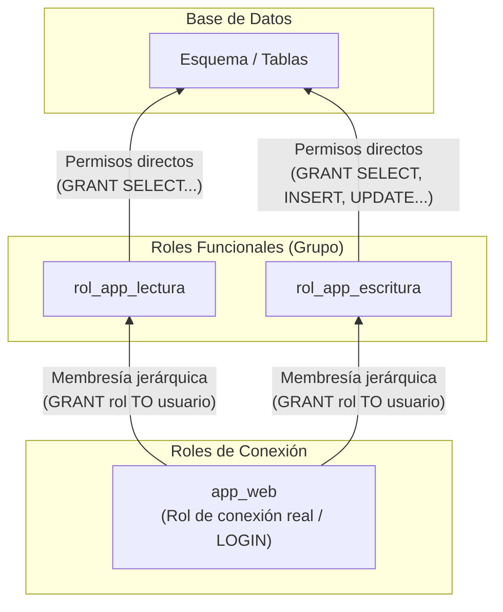

**TECNICATURA UNIVERSITARIA** 

**EN PROGRAMACIÓN** 

# ~~a~~ 


<!-- Start of picture text -->
XUTN<br><!-- End of picture text -->

## **Guía Teórico-Práctica: Gestión de Identidades, Permisos Granulares y Jerarquías de Roles en PostgreSQL** 

En la administración profesional de bases de datos relacionales, el control de acceso constituye la primera y más crítica línea de defensa. Operar en entornos de producción exige desterrar el uso de cuentas genéricas o privilegios desmedidos, aplicando de forma estricta el **principio de mínimo privilegio** : toda identidad debe contar exactamente con las facultades necesarias para ejecutar su labor técnica, ni una más. 

A continuación, se detalla el funcionamiento conceptual y la implementación técnica en PostgreSQL (versión 16+) para crear usuarios, conceder privilegios a nivel de tabla, columna y fila, definir roles de grupo y estructurar jerarquías de roles asignando conexiones de forma segura. 

### **1. El concepto unificado de ROLE en PostgreSQL** 

A diferencia de otros sistemas gestores de bases de datos que mantienen entidades separadas para "usuarios" y "grupos", **PostgreSQL unifica ambos conceptos bajo un único objeto de catálogo: el ROLE** . 

- **Rol de grupo:** Es un rol configurado con la cláusula NOLOGIN. No puede autenticarse ni abrir sesiones por sí mismo; su única finalidad es agrupar un conjunto de privilegios sobre el esquema y los datos. 

- **Rol de usuario / conexión (login):** Es un rol configurado con la cláusula LOGIN y habitualmente una credencial cifrada (PASSWORD). Representa una conexión real (una persona o un servicio/aplicación backend). 

- **Sintaxis equivalente:** Ejecutar CREATE USER nombre; es una equivalencia léxica ( _azúcar sintáctico_ ) de CREATE ROLE nombre WITH LOGIN;. 

### **2. Creación y Configuración de Usuarios (Roles de Login)** 

Al instanciar identidades que se conectarán al motor, es fundamental limitar su alcance desde la creación. 

#### **Sintaxis y atributos esenciales** 

- **CREATE ROLE app_web WITH LOGIN** 

- l **PASSWORD 'cambiar_en_produccion'** 

- **CONNECTION LIMIT 50** 

- **VALID UNTIL '2027-01-01';** 

Página **1** de **8** 

**TECNICATURA UNIVERSITARIA EN PROGRAMACIÓN** 

# ~~a~~ 


<!-- Start of picture text -->
XUTN<br><!-- End of picture text -->

#### **Parámetros clave** 

- LOGIN: Habilita al rol a autenticarse y abrir una sesión interactiva o de aplicación. 

- PASSWORD '...': Almacena la credencial protegida con un algoritmo criptográfico (por defecto SCRAM-SHA-256 en versiones modernas); el motor nunca la almacena en texto plano. 

- CONNECTION LIMIT : Acota la cantidad máxima de conexiones concurrentes abiertas por este rol. Evita el agotamiento de recursos del servidor ante ataques o errores de pooling en la aplicación. 

- VALID UNTIL '': Establece una fecha y hora límite de expiración para la credencial, obligando a su rotación periódica. 

- **Regla de oro sobre privilegios administrativos:** Salvo para el administrador del sistema, **nunca** se debe otorgar SUPERUSER, CREATEDB ni CREATEROLE a roles de aplicación. Un usuario con atributo SUPERUSER ignora por completo cualquier comprobación de permisos del motor, anulando el modelo de seguridad. 

### **3. Asignación de Permisos Granulares (GRANT / REVOKE)** 

El punto de partida de cualquier rol nuevo en PostgreSQL es **cero privilegios sobre objetos ajenos** . Para que un rol pueda interactuar con tablas o rutinas, el acceso debe concederse paso a paso. 

**Requisito fundamental (Uso de esquema):** Antes de interactuar con cualquier tabla o vista de un esquema determinado (por ejemplo, public), el rol debe tener explícitamente el permiso USAGE sobre dicho esquema. Sin USAGE, el motor denegará cualquier operación interna aunque la tabla tenga permisos concedidos. 

###### **GRANT USAGE ON SCHEMA public TO rol_nombre;** 

#### **3.1. Permisos a Nivel de Tabla** 

Permiten controlar operaciones globales de manipulación (DML) sobre una relación completa: 

**<mark>-- Conceder lectura sobre el catálogo de productos</mark> GRANT SELECT ON** **<mark>public.producto</mark> TO** **<mark>rol_app_lectura;</mark>** 

**<mark>-- Conceder lectura, inserción y modificación sobre pedidos (sin permitir DELETE)</mark> GRANT SELECT** **<mark>,</mark> INSERT** **<mark>, UPDATE</mark> ON** **<mark>public.pedido, public.detalle_pedido</mark> TO** **<mark>rol_app_escritura;</mark>** 

**<mark>-- Revocar explícitamente operaciones destructivas</mark> REVOKE DELETE** **<mark>,</mark> TRUNCATE ON** **<mark>public.pedido, public.detalle_pedido</mark> FROM** **<mark>rol_app_escritura;</mark>** 


Página **2** de **8** 

~~a~~ 

**EN PROGRAMACIÓN** 

###### **TECNICATURA UNIVERSITARIA** 


<!-- Start of picture text -->
XUTN<br><!-- End of picture text -->

- **Privilegios comunes:** SELECT, INSERT, UPDATE, DELETE, TRUNCATE, REFERENCES. 

- _Consideración de diseño:_ En arquitecturas con borrado lógico (mediante flags como eliminado = TRUE), revocar el comando físico DELETE y TRUNCATE reduce drásticamente el riesgo de pérdida irreversible de información ante bugs o fallas. 

#### **3.2. Permisos a Nivel de Columna (Proyección Restringida)** 

Cuando una tabla contiene una mezcla de atributos operativos y atributos altamente confidenciales (como contraseñas, documentos o salarios), PostgreSQL permite delimitar el permiso a columnas concretas entre paréntesis: 

**-- Permitir que el rol de soporte consulte solo información básica de usuarios GRANT SELECT (id, nombre, apellido, mail, rol) ON public.usuario TO rol_soporte;** 

**-- Permitir actualización únicamente de un campo operativo específico GRANT UPDATE (estado_pedido) ON public.pedido TO rol_repartidor;** 

Si una consulta intenta ejecutar SELECT * o referenciar columnas no autorizadas (como contrasena o celular en el caso de soporte), el motor aborta la sentencia con un error de violación de permisos (permission denied for column ...). 

#### **3.3. Permisos a Nivel de Fila: Row-Level Security (RLS)** 

Mientras que los permisos de columna filtran de forma vertical, la **Seguridad a Nivel de Fila (RLS)** restringe el acceso de forma horizontal: **controla cuáles filas individuales son visibles u operables por cada rol** . 

Permite sustituir o respaldar los filtros manuales que escribe el desarrollador en la aplicación (como WHERE usuario_id = ...) haciendo que el motor garantice el aislamiento de registros de manera obligatoria. 

##### **Implementación paso a paso:** 

1. **Activar RLS en la tabla objetivo:** 

**ALTER TABLE public.pedido ENABLE ROW LEVEL SECURITY;** 

2. **Definir la política de acceso (POLICY):** 

   - **CREATE POLICY pedidos_propios ON public.pedido FOR ALL** 

**TO rol_app_escritura** 

**USING (usuario_id = current_setting('app.usuario_actual', true)::bigint);** 

- **Mecánica:** Cuando la sesión ejecuta SELECT * FROM pedido;, PostgreSQL inyecta internamente la condición booleana declarada en la directiva USING. 

Página **3** de **8** 

**TECNICATURA UNIVERSITARIA EN PROGRAMACIÓN** 


<!-- Start of picture text -->
UNIVERSIDAD TECNOLOGICA NACIONAL<br><!-- End of picture text -->

- Si la aplicación web fijó la variable en la conexión mediante SET LOCAL app.usuario_actual = '105', el usuario solo obtendrá las filas pertenecientes a su identificador. El motor omite silenciosamente el resto de las tuplas, impidiendo cualquier escalamiento horizontal de privilegios entre clientes. 

### **4. Creación de Roles de Grupo y Estructuración de Jerarquías** 

La mejor práctica de arquitectura en bases de datos consiste en **separar las autorizaciones (qué se puede hacer) de las credenciales de conexión (quién se conecta)** . Esto se resuelve mediante una jerarquía basada en roles de grupo. 


```text
            ----------------
            |Esquema/Tablas|
            --------^-------
                    | Permisos directos (GRANT SELECT, INSERT...)
        -------------------------
        |                       |
-----------------       -------------------
|rol_app_lectura|       |rol_app_escritura| (Roles funcionales)
--------^--------       --------^----------
        |                       |
        -------------------------
                    | Membresía jerárquica (GRANT rol TO usuario)
                ---------
                |app_web| (Rol de conexión real / LOGIN)
                ---------
```



**Paso 1: Crear los roles de grupo (sin capacidad de login)** 

Se definen según funciones de negocio o áreas operativas de la plataforma: 

**CREATE ROLE rol_app_lectura NOLOGIN; CREATE ROLE rol_app_escritura NOLOGIN; CREATE ROLE rol_soporte NOLOGIN; CREATE ROLE rol_reportes NOLOGIN;** 

#### **Paso 2: Conceder permisos de objetos a los roles de grupo** 

**-- 1. Habilitar acceso al esquema** 

**GRANT USAGE ON SCHEMA public TO rol_app_lectura, rol_app_escritura, rol_soporte, rol_reportes;** 

**-- 2. Asignar privilegios a los grupos funcionales** 

Página **4** de **8** 

**EN PROGRAMACIÓN** 

# ~~a~~ 

###### **TECNICATURA UNIVERSITARIA** 


<!-- Start of picture text -->
XUTN<br><!-- End of picture text -->

**GRANT SELECT ON public.v_productos_vigentes, public.v_categorias_vigentes TO rol_app_lectura;** 

**GRANT SELECT, INSERT, UPDATE ON public.pedido, public.detalle_pedido TO rol_app_escritura;** 

**GRANT SELECT ON public.v_usuarios_publico, public.v_pedidos_resumen TO rol_soporte;** 

**GRANT SELECT ON public.mv_ventas_categoria_mes TO rol_reportes;** 

#### **Paso 3: Crear los usuarios de login reales** 

**-- Conexión técnica consumida por el backend web CREATE ROLE app_web WITH LOGIN PASSWORD 'PwdSegura_Web_2026';** 

**-- Conexión de un operador humano de mesa de ayuda** 

**CREATE ROLE operador_juan WITH LOGIN PASSWORD 'PwdSegura_Juan_2026';** 

#### **Paso 4: Establecer la jerarquía mediante asignación de membresía** 

Para asociar un usuario a uno o más grupos, se utiliza GRANT TO : 

**-- El backend web hereda permisos de lectura y escritura GRANT rol_app_lectura, rol_app_escritura TO app_web;** 

**-- El operador hereda únicamente el rol de soporte GRANT rol_soporte TO operador_juan;** 

### **5. Control de Sesión y Permisos Futuros** 

#### **Herencia (INHERIT) y Cambio de Contexto Temporal (SET ROLE)** 

- Por omisión, los roles en PostgreSQL poseen el atributo INHERIT, lo que significa que el usuario de login hereda de forma automática y transparente todos los privilegios del grupo al que pertenece. 

- Para tareas administrativas o de depuración, un usuario con múltiples permisos puede autolimitar su alcance momentáneamente para reducir la superficie de error mediante SET ROLE: 

Página **5** de **8** 

**EN PROGRAMACIÓN** 

# ~~a~~ 

###### **TECNICATURA UNIVERSITARIA** 


<!-- Start of picture text -->
XUTN<br><!-- End of picture text -->

**-- Limitar la sesión actual a las capacidades de soporte** 

**SET ROLE rol_soporte;** 

**-- Verificar o ejecutar tareas acotadas...** 

**-- Retornar a los privilegios originales de la identidad RESET ROLE;** 

#### **Automatización de permisos sobre nuevas tablas (ALTER DEFAULT PRIVILEGES)** 

Por defecto, la sentencia GRANT ordinaria solo impacta en tablas ya existentes. Para evitar que tablas o vistas añadidas en futuras migraciones queden inaccesibles o exijan asignaciones manuales urgentes, se configuran privilegios predeterminados: 

**ALTER DEFAULT PRIVILEGES FOR ROLE admin_datos IN SCHEMA public GRANT SELECT ON TABLES TO rol_reportes;** 

Con esta instrucción, cada vez que el rol admin_datos ejecute un CREATE TABLE o CREATE VIEW dentro del esquema public, el rol rol_reportes obtendrá de forma automática el permiso de SELECT sobre dicho objeto nuevo. 

### **6. Script Consolidado de Implementación** 

El siguiente bloque resume el despliegue ordenado de una arquitectura completa de usuarios, permisos granulares y jerarquía de roles: 

- **-- ========================================================** 

**-- 1. CREACIÓN DE ROLES DE GRUPO (Sin Login)** 

- **-- ========================================================** 

**CREATE ROLE rol_app_lectura NOLOGIN; CREATE ROLE rol_app_escritura NOLOGIN;** 

**CREATE ROLE rol_soporte NOLOGIN;** l 

**-- ========================================================** 

**-- 2. ACCESO AL ESQUEMA Y PERMISOS DE TABLA** 

- **-- ========================================================** 

**GRANT USAGE ON SCHEMA public TO rol_app_lectura, rol_app_escritura, rol_soporte;** 

**-- Permisos sobre tablas y vistas GRANT SELECT ON public.v_productos_vigentes TO rol_app_lectura; GRANT SELECT, INSERT, UPDATE ON public.pedido TO rol_app_escritura;** 

Página **6** de **8** 

**EN PROGRAMACIÓN** 

# ~~a~~ 

###### **TECNICATURA UNIVERSITARIA** 


<!-- Start of picture text -->
XUTN<br><!-- End of picture text -->

**REVOKE DELETE, TRUNCATE ON public.pedido FROM rol_app_escritura;** 

**-- ========================================================** 

**-- 3. PERMISOS POR COLUMNA** 

**-- ========================================================** 

**-- Soporte sólo puede leer datos identificatorios básicos GRANT SELECT (id, nombre, apellido, mail) ON public.usuario TO rol_soporte;** l 

**-- ========================================================** 

**-- 4. PERMISOS POR FILA (Row-Level Security) -- ========================================================** 

**ALTER TABLE public.pedido ENABLE ROW LEVEL SECURITY;** 

**CREATE POLICY aislacion_clientes_pedido ON public.pedido FOR ALL** 

**TO rol_app_escritura USING (usuario_id = current_setting('app.usuario_actual', true)::bigint);** 

**-- ======================================================== -- 5. CREACIÓN DE USUARIOS DE CONEXIÓN (Con Login)** 

**-- ======================================================== CREATE ROLE app_web WITH LOGIN PASSWORD 'ClaveSuperSeguraApp2026!'; CREATE ROLE analista_soporte WITH LOGIN PASSWORD 'ClavePersonalSoporte2026!';** 

**-- ======================================================== -- 6. ASIGNACIÓN JERÁRQUICA (Membresías) -- ========================================================** 

**GRANT rol_app_lectura, rol_app_escritura TO app_web; GRANT rol_soporte TO analista_soporte;** 

### **7. Verificación del Estado de Seguridad en el Catálogo** 

Para auditar y comprobar que la jerarquía y los permisos fueron correctamente concedidos sin otorgar atributos excesivos, se pueden consultar las vistas nativas del catálogo del motor: 

-- 1. Inspeccionar roles, atributos administrativos y límites 

**SELECT rolname, rolcanlogin, rolsuper, rolcreaterole, rolcreatedb, rolconnlimit FROM pg_roles WHERE rolname IN ('app_web', 'analista_soporte', 'rol_soporte', 'rol_app_escritura');** 

**-- 2. Verificar membresías y jerarquías de roles SELECT r.rolname AS rol_usuario, m.rolname AS rol_grupo_heredado** 

Página **7** de **8** 

~~a~~ 

**TECNICATURA UNIVERSITARIA EN PROGRAMACIÓN** 


<!-- Start of picture text -->
XUTN<br><!-- End of picture text -->

**FROM pg_roles r JOIN pg_auth_members am ON r.oid = am.member JOIN pg_roles m ON am.roleid = m.oid;** 

**-- 3. Consultar la matriz de privilegios otorgados sobre tablas SELECT grantee, table_schema, table_name, privilege_type FROM information_schema.role_table_grants WHERE table_schema = 'public' ORDER BY table_name, grantee;** 

Con este esquema se garantiza que la aplicación solo ejecute lo estrictamente autorizado, impidiendo la manipulación accidental o maliciosa del esquema y aislando eficazmente los datos confidenciales. 

Página **8** de **8** 

