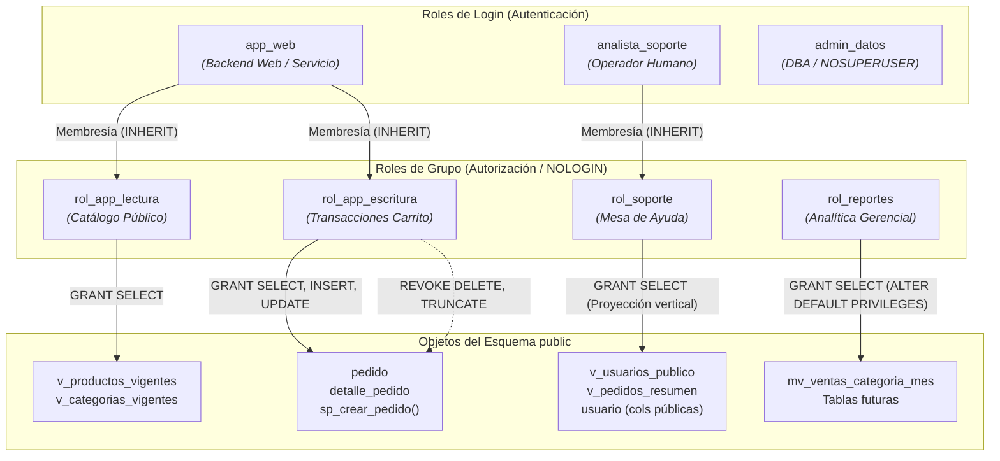

# Especificación de Diseño Técnico de Roles y Permisos (Kiro Spec)

## Proyecto: Food Store — Base de Datos II (UTN)
**Módulo:** Arquitectura de Control de Acceso y Modelo de Privilegios (TP7 - Parte A)  
**Motor:** PostgreSQL 16+  

---

### 1. Diagrama de Jerarquía de Roles y Asignación de Privilegios

El siguiente diagrama modela la separación entre identidades de conexión (quién se conecta) y roles funcionales de grupo (qué se puede hacer):



---

### 2. Matriz Granular de Autorizaciones: Rol × Objeto × Privilegio

| Rol | Objeto | Privilegios Otorgados | Privilegios Revocados / Denegados | Justificación Técnica de Mínimo Privilegio |
| :--- | :--- | :--- | :--- | :--- |
| **`rol_app_lectura`** | `SCHEMA public` | `USAGE` | `CREATE` | Permite resolver nombres de objetos dentro del esquema sin habilitar creación de tablas. |
| **`rol_app_lectura`** | `v_productos_vigentes`, `v_categorias_vigentes` | `SELECT` | `INSERT`, `UPDATE`, `DELETE`, `TRUNCATE` | Sirve el catálogo público de la tienda aislando productos o categorías descontinuadas. |
| **`rol_app_escritura`** | `SCHEMA public` | `USAGE` | `CREATE` | Permite interactuar con los objetos del esquema público. |
| **`rol_app_escritura`** | `pedido`, `detalle_pedido` | `SELECT`, `INSERT`, `UPDATE` | `DELETE`, `TRUNCATE` | Habilita el registro de compras de clientes, bloqueando borrados físicos para garantizar auditoría y borrado lógico. |
| **`rol_app_escritura`** | `ALL SEQUENCES IN SCHEMA public` | `USAGE`, `SELECT` | — | Necesario para que las claves autogeneradas (Identity) avancen en cada `INSERT`. |
| **`rol_app_escritura`** | `sp_crear_pedido(...)` | `EXECUTE` | — | Permite disparar la rutina transaccional de verificación de stock e inserción atómica de pedido. |
| **`rol_soporte`** | `SCHEMA public` | `USAGE` | `CREATE` | Acceso de uso al esquema. |
| **`rol_soporte`** | `v_usuarios_publico`, `v_pedidos_resumen` | `SELECT` | `INSERT`, `UPDATE`, `DELETE` | Permite atender consultas y reclamos de clientes sin capacidad de alterar datos maestros ni órdenes. |
| **`rol_soporte`** | `usuario (columnas id, nombre, apellido, mail, rol)` | `SELECT` (granular) | `SELECT (contrasena, celular)` | Restringe a nivel de columna la visibilidad para que ni siquiera un `SELECT *` exponga hashes de claves ni teléfonos privados. |
| **`rol_soporte`** | `fn_resetear_password(...)` | `EXECUTE` | — | Función `SECURITY DEFINER` acotada que permite restablecer contraseñas de usuarios sin otorgar `UPDATE` a la tabla base. |
| **`rol_reportes`** | `SCHEMA public` | `USAGE` | `CREATE` | Acceso de uso al esquema. |
| **`rol_reportes`** | `mv_ventas_categoria_mes` | `SELECT` | `INSERT`, `UPDATE`, `DELETE` | Habilita dashboards gerenciales analíticos sin competir por bloqueos en tablas transaccionales. |
| **`app_web`** | Membresía de grupos | Hereda `rol_app_lectura` y `rol_app_escritura` | Sin atributos de superusuario ni admin | Conexión del backend web con facultades justas para navegación y checkout. |
| **`admin_datos`** | Nivel Servidor / Esquema | `CREATEDB`, `CREATEROLE`, Dueño de objetos | `NOSUPERUSER` | Administrador de base de datos que puede desplegar esquemas pero queda sujeto al control de auditoría del motor. |

---

### 3. Mecanismos de Aislamiento y Endurecimiento

#### 3.1. Row-Level Security (RLS) sobre `pedido`
- **Problema:** En arquitecturas multicomprador, un bug en la cláusula `WHERE` del backend podría filtrar compras de otros clientes.
- **Solución implementada:** Se activa RLS en la tabla `pedido`:
  ```sql
  ALTER TABLE pedido ENABLE ROW LEVEL SECURITY;
  CREATE POLICY aislacion_clientes_pedido ON pedido
      FOR ALL
      TO rol_app_escritura
      USING (cliente_id = current_setting('app.usuario_actual', true)::bigint);
  ```
  El motor PostgreSQL evalúa obligatoriamente la regla en cada consulta, impidiendo cualquier escalamiento horizontal entre clientes.

#### 3.2. Automatización de Permisos Futuros (`ALTER DEFAULT PRIVILEGES`)
- **Problema:** Cada nueva migración o vista analítica creada por el DBA exigiría ejecutar `GRANT` manuales, derivando en caídas de servicio o permisos apresurados.
- **Solución implementada:**
  ```sql
  ALTER DEFAULT PRIVILEGES FOR ROLE admin_datos IN SCHEMA public
      GRANT SELECT ON TABLES TO rol_reportes;
  ```

---

### 4. Consultas de Verificación en el Catálogo

Para auditar y validar la correspondencia 1:1 entre esta especificación y la base de datos:

1. **Atributos de login y límites:**
   ```sql
   SELECT rolname, rolcanlogin, rolsuper, rolcreaterole, rolcreatedb, rolconnlimit
   FROM pg_roles
   WHERE rolname IN ('app_web', 'admin_datos', 'rol_app_lectura', 'rol_app_escritura', 'rol_soporte', 'rol_reportes')
   ORDER BY rolname;
   ```
2. **Jerarquía y membresías:**
   ```sql
   SELECT r.rolname AS usuario_login, m.rolname AS grupo_heredado
   FROM pg_roles r
   JOIN pg_auth_members am ON r.oid = am.member
   JOIN pg_roles m ON am.roleid = m.oid
   ORDER BY r.rolname;
   ```
3. **Privilegios granulares sobre tablas:**
   ```sql
   SELECT grantee, table_name, privilege_type
   FROM information_schema.role_table_grants
   WHERE table_schema = 'public'
   ORDER BY table_name, grantee, privilege_type;
   ```
