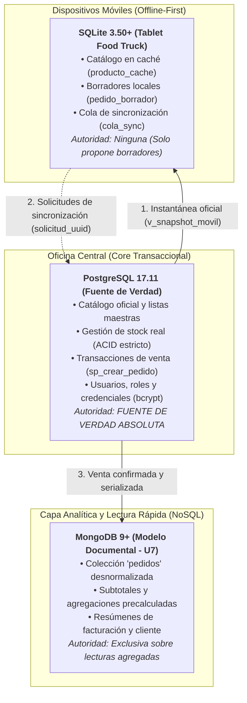

# TRABAJO PRÁCTICO INTEGRADOR — SEGUNDA ENTREGA PARCIAL
## Proyecto Integrador «Food Store» · Consolidación de Unidades 4 a 8
### Asignatura: Base de Datos II — Tecnicatura Universitaria en Programación (UTN)

**Estudiante / Integrante:** Cristian Rodriguez (`Cloverfield`)  
**Carrera:** Tecnicatura Universitaria en Programación  
**Materia:** Base de Datos II · Ciclo Lectivo 2026  
**Rama de Entrega:** `tpi-parcial2`  
**Motores de Referencia:**
* **PostgreSQL 16+ (PostgreSQL 17.11):** Núcleo Transaccional ACID y Fuente de Verdad Central.
* **MongoDB 9+ (MongoDB 9.0.4 Community):** Capa Documental y Lectura Agregada NoSQL.
* **SQLite 3.37+ (SQLite 3.50.4):** Motor Embebido para Dispositivos Móviles en Modo `STRICT`.

---

## 1. Introducción y Alcance

El presente informe documenta de manera integral y verificable la **segunda entrega parcial del Trabajo Práctico Integrador (TPI)** correspondiente al proyecto **«Food Store»** en la asignatura Base de Datos II.

Mientras que la primera entrega parcial consolidó los fundamentos del modelo relacional, las restricciones de integridad declarativas, las transacciones ACID, el control de concurrencia y la optimización inicial con índices B-Tree y vistas en PostgreSQL (Unidades 1 a 3), esta segunda entrega completa la **capa de datos integral del proyecto**. 

En esta etapa se acreditan de forma práctica, documentada y reproducible los conocimientos avanzados desarrollados en las **Unidades 4 a 8**:
1. **Unidad 4 · Normalización avanzada y redundancia:** Refactorización de esquemas heredados con dependencias funcionales complejas hasta la Forma Normal de Boyce-Codd (FNBC), migración reversible sin pérdida (*lossless-join*) con plan de contingencia obligatorio y desnormalización controlada mediante vistas materializadas de refresco concurrente.
2. **Unidad 5 · Administración y seguridad:** Jerarquías de roles bajo el principio de mínimo privilegio, auditoría selectiva a nivel de motor (`log_statement = 'mod'`), laboratorio de contención de incidentes de acceso indebido, funciones criptográficas (`pgcrypto`) y anonimización de datos en cumplimiento de la Ley Nacional 25.326.
3. **Unidad 6 · Mantenimiento y continuidad operativa:** Plan preventivo de mantenimiento automatizado, volcado lógico nativo en formato *custom* (`pg_dump -Fc`), monitoreo proactivo en cuatro dimensiones de salud y simulacro contra reloj de recuperación ante desastres (*Disaster Recovery*) con medición empírica de RTO y RPO.
4. **Unidad 7 · NoSQL y nuevas formas de almacenamiento:** Modelado documental desnormalizado en MongoDB bajo el patrón *Aggregate Root*, migración de pedidos históricos preservando granularidades y precios pactados, consultas documentales sobre datos reales y evaluación crítica de la persistencia políglota frente a PostgreSQL.
5. **Unidad 8 · Bases de datos móviles e integración:** Arquitectura *Offline-First* para terminales móviles (tablets de Food Truck en ferias gastronómicas) basada en SQLite `STRICT`, exportación e importación de instantáneas con centavos y lápidas (*tombstones*), resolución asimétrica de conflictos mediante el algoritmo del Semáforo y code review final asistido por Inteligencia Artificial.

Todas las implementaciones se sustentan en evidencias empíricas comprobables en los motores de base de datos, rigurosamente especificadas mediante la metodología Kiro (notación EARS) y gobernadas por el Protocolo Obligatorio de Uso de Inteligencia Artificial.

---

## 2. Arquitectura Integral de la Capa de Datos

El ecosistema tecnológico de Food Store resuelve los desafíos operativos, analíticos y de movilidad mediante una **arquitectura de datos distribuida y políglota**, donde cada motor desempeña un oficio técnico especializado sin competir entre sí:



### 2.1. Matriz de Distribución de Autoridad y Responsabilidades

| Motor | Rol Arquitectónico | Datos Almacenados | Autoridad Decisoria | Tecnologías Clave |
| :--- | :--- | :--- | :--- | :--- |
| **PostgreSQL 17.11** | **Núcleo Transaccional Central** | Catálogo oficial maestro, inventario en tiempo real, clientes, pedidos formales confirmados, líneas de detalle, credenciales criptográficas y trazas de auditoría. | **Fuente de Verdad Única (*Single Source of Truth*)**. Autoridad absoluta sobre precios vigentes, asignación de stock y confirmación de ventas bajo aislamiento ACID. | PL/pgSQL, `pgcrypto`, `TIMESTAMPTZ`, triggers diferibles, vistas materializadas. |
| **MongoDB 9.0.4** | **Capa Documental y Analítica** | Colección documental desnormalizada `pedidos`, conteniendo cabeceras, subdocumentos de clientes, arreglos de líneas con subtotales precalculados e importes totales. | **Autoridad delegada de lectura agregada**. Optimiza dashboards y reporting de alta concurrencia sin recargar el motor OLTP relacional. | BSON, Aggregation Framework, *Single-Document Atomicity*, índices multikey. |
| **SQLite 3.50.4** | **Capa de Movilidad Desconectada** | Caché local del catálogo (`producto_cache`), borradores transitorios (`pedido_borrador`, `item_borrador`) y estados del semáforo (`cola_sync`). | **Sin autoridad decisoria**. Libreta de trabajo desconectada que únicamente prepara borradores para someter a evaluación del servidor. | Modo `STRICT`, precios en centavos enteros (`INTEGER`), claves foráneas activas. |

### 2.2. La Regla de Oro: *"El móvil propone, el servidor dispone"*
En ningún escenario un dispositivo periférico (tablet, terminal de comandas o panel web) tiene potestad para decrementar existencias, alterar precios de lista o auto-aprobar una venta. La tablet opera en modo desconectado armando propuestas de pedidos identificadas por `solicitud_uuid`; al restablecer el enlace de red, es **PostgreSQL** quien evalúa las condiciones comerciales y de inventario mediante bloqueos transaccionales pesimistas (`SELECT ... FOR UPDATE`), decidiendo si la transacción se consolida o se rechaza.

---

## 3. Elementos Implementados por Unidad (Unidades 4 a 8)

### 3.1. Unidad 4 · Normalización Avanzada y Redundancia
* **Refactorización FNBC:** Identificación y demostración matemática de la violación de FNBC en el esquema logístico heredado `control_lote_almacen(lote_id, deposito_id, responsable_control_id)`. Descomposición en dos relaciones independientes: `responsable_deposito(responsable_control_id, deposito_id)` y `control_lote(lote_id, responsable_control_id)`.
* **Descomposición sin pérdida demostrada:** Aplicación formal del Criterio de Heath demostrando que la intersección $\{responsable\_control\_id\}$ determina a $deposito\_id$, garantizando que la reunión natural $R_1 \bowtie R_2$ no produce tuplas espurias.
* **Vista de compatibilidad:** Implementación de `v_control_lote_almacen` mediante un `JOIN` interno que preserva la interfaz del sistema legado con 0 diferencias en comparaciones de conjuntos (`EXCEPT`).
* **Migración transaccional y reversibilidad:** Script canónico `db/tp_fnbc_control_lote.sql` ejecutado dentro de un bloque `BEGIN ... COMMIT` con sección de diagnóstico de solo lectura y plan de reversión obligatorio (`ROLLBACK`).
* **Desnormalización controlada:** Creación de la vista materializada `mv_ventas_categoria_dia` en `db/tp_desnormalizacion_top_categorias.sql`, soportada por un índice único compuesto sobre `(fecha, categoria_id)` para admitir refrescos no bloqueantes (`REFRESH MATERIALIZED VIEW CONCURRENTLY`).
* **Auditoría de sincronización:** Consulta de auditoría automatizada basada en `FULL OUTER JOIN` que compara diariamente los datos materializados frente al recálculo dinámico en las tablas base.

### 3.2. Unidad 5 · Administración y Seguridad
* **Jerarquía de roles y mínimo privilegio:** Implementación en `sql/roles.sql` de una estructura granular:
  - Roles de grupo sin login (`NOLOGIN`): `rol_app_lectura` (vistas de catálogo sanitizadas), `rol_app_escritura` (operaciones DML controladas con revocación explícita de `DELETE` y `TRUNCATE`), `rol_soporte` (lectura proyectada a nivel de columna) y `rol_reportes` (acceso exclusivo a vistas agregadas).
  - Identidad técnica de conexión (`LOGIN`): `app_web`, limitado a 50 conexiones concurrentes y expiración definida.
  - Administrador de base de datos: `admin_datos` con privilegios `CREATEDB` y `CREATEROLE`, excluyendo taxativamente el atributo `SUPERUSER`.
* **Auditoría nativa del servidor:** Activación y parametrización de directivas nativas del cluster en `sql/tp7_clase1_auditoria_servidor.sql`: `log_connections = on`, `log_disconnections = on` y `log_statement = 'mod'` (filtrando lecturas rutinarias y capturando mutaciones de datos y esquemas).
* **Laboratorio de incidente de acceso indebido:** Reproducción controlada en `sql/simulacro_incidente.sql` de un ataque de fuerza bruta contra `fn_autenticar`, exfiltración no autorizada de la tabla `usuario` e intentos fallidos de escalamiento vertical a `SUPERUSER`.
* **Protocolo de contención inmediata:** Procedimiento seguro de invalidación y restablecimiento forzado de contraseñas mediante la función PL/pgSQL `fn_resetear_password` configurada con `SECURITY DEFINER` y fijación explícita de `search_path = public, pg_temp`.
* **Protección de datos personales (Ley 25.326):** Construcción del dataset sintético determinista `usuario_anon` (`sql/usuario_anon.sql`), eliminando identificadores directos (teléfonos `NULL`, contraseñas neutralizadas) y preservando métricas de cardinalidad para el trabajo analítico con asistentes de IA.

### 3.3. Unidad 6 · Mantenimiento y Resiliencia
* **Especificación formal del plan (SPEC_U6):** Definición de la matriz de rutinas operativas en `docs/tp8/SPEC_U6.md`, estableciendo ventanas horarias nocturnas (02:00 AM para backups, 03:00 AM para mantenimiento), condiciones de éxito y directivas de seguridad.
* **Respaldo automatizado desatendido:** Scripts en PowerShell (`docs/tp8/backup_foodstore.ps1`) y Bash (`docs/tp8/backup_foodstore.sh`) que ejecutan `pg_dump` en formato *custom* (`-Fc`), compresión zlib integrada, marcas temporales `YYYYMMDD_HHMMSS` y verificación estricta de códigos de retorno sin exponer credenciales.
* **Monitoreo integral de salud:** Script de diagnóstico `sql/health_check.sql` que audita cuatro dimensiones críticas: espacio ocupado por base e índices, ratio de transacciones commit vs. rollback, tuplas muertas/actividad de autovacuum y detección de bloqueos o consultas de larga duración.
* **Mantenimiento no bloqueante:** Script `sql/maintenance.sql` que aplica `VACUUM (VERBOSE, ANALYZE)` sobre tablas transaccionales de alto movimiento (`pedido`, `detalle_pedido`), fundamentando técnicamente la prohibición de `VACUUM FULL`.
* **Simulacro de desastre contra reloj:** Automatización del ensayo de recuperación en `docs/tp8/restore_test.ps1` sobre la base estéril `foodstore_restore_test`, midiendo métricas de RTO y RPO y ejecutando aserciones de consistencia referencial y de dominio.

### 3.4. Unidad 7 · NoSQL y Almacenamiento Documental
* **Modelado documental en MongoDB:** Diseño del esquema `pedidos` en la base `foodstore_nosql` bajo el patrón *Aggregate Root*, consolidando en un único documento BSON el identificador relacional original (`_id: NumberLong`), subdocumento `cliente`, arreglo de subdocumentos `lineas` con subtotales precalculados e importe `total`.
* **Migración de datos reales:** Script `docs/tp9/consultas_mongodb.js` que migra de forma idempotente 5 pedidos representativos preservando precios unitarios históricos pactados y asegurando la cardinalidad mínima de ítems.
* **Consultas documentales nativas:** Implementación y prueba en `mongosh` de cuatro consultas representativas: proyección general (4a), filtrado operacional por estado `ENTREGADO` (4b), búsqueda indexada en arreglos internos por `producto_id` (4c) y segmentación de consumo mediante umbrales de importe con `$gt` (4d).
* **Contraste relacional en PostgreSQL:** Implementación en `docs/tp9/consultas_postgresql.sql` de las sentencias SQL equivalentes para los pedidos 1 a 5, comparando el rendimiento y la complejidad estructural de navegar subdocumentos vs. ejecutar reuniones relacionales con `JOIN` y `DISTINCT`.

### 3.5. Unidad 8 · Bases de Datos Móviles e Integración
* **Modelo móvil en SQLite (Modo STRICT):** Creación del esquema `movil/schema_sqlite.sql` para tablets de Food Trucks, estructurando las tablas `producto_cache`, `pedido_borrador`, `item_borrador` (precios enteros en centavos para eliminar fallas de coma flotante), `snapshot_servidor` y `cola_sync`, con verificación de claves foráneas activas (`PRAGMA foreign_keys = 1`).
* **Sincronización asimétrica:** Vista receptora en PostgreSQL `v_snapshot_movil` (`movil/postgresql_snapshot.sql`) con centavos y lápidas (*tombstones* `eliminado = true`), serializada en `servidor_snapshot.csv` e importada en SQLite mediante `movil/snapshot_servidor.sql`.
* **Motor del Semáforo:** Consulta evaluadora en `movil/semaforo.sql` que dictamina en tiempo real sobre solicitudes en estado `PENDIENTE`:
  - **ROJO (`RECHAZADO`):** Falta de stock, producto inactivo o lápida activa (precedencia absoluta).
  - **AMARILLO (`CONFLICTO`):** Cambio tarifario entre el catálogo visto por el cliente y el precio vigente en el servidor.
  - **VERDE (`SIMULADO_APROBADO`):** Coincidencia total de existencias, estado y tarifa.
* **Suite de simulación automatizada:** Script `movil/simulador_casos.py` que comprueba de forma reproducible los escenarios C1 a C7: atención desconectada (C1), conflicto tarifario resuelto en mostrador (C2), quiebre de stock rechazado (C3), producto dado de baja lógica rechazado (C4), solicitud limpia aprobada (C5), idempotencia ante reintentos de red (C6) y rechazo de violaciones de integridad física en la tablet (C7).

---

## 4. Cobertura Explícita de los Objetivos de la Entrega

La siguiente matriz acredita el cumplimiento formal y verificable de la totalidad de los objetivos exigidos por la cátedra para la aprobación de la segunda entrega:

| Unidad | Requisito Exigido por la Cátedra | Componente / Script en el Repositorio | Evidencia y Verificación | Estado |
| :---: | :--- | :--- | :--- | :---: |
| **U4** | Refactorización de esquema heredado a FNBC validada contra DFs reales. | `db/tp_fnbc_control_lote.sql`<br>`docs/tp6/informe_fnbc.md` | Demostración matemática formal de $R \rightarrow D$; clausuras $K = \{\{L,D\}, \{L,R\}\}$. Descomposición en `responsable_deposito` y `control_lote`. | **Acreditado** |
| **U4** | Migración sin pérdida en transacciones reversibles con plan de reversión. | `db/tp_fnbc_control_lote.sql`<br>`docs/tp6/kiro/rollback_plan.md` | Bloque `BEGIN ... COMMIT` con `OVERRIDING SYSTEM VALUE`, validación bidireccional con `EXCEPT` (0 diferencias) y protocolo de `ROLLBACK`. | **Acreditado** |
| **U4** | Decisiones de desnormalización controlada con salvaguardas documentadas. | `db/tp_desnormalizacion_top_categorias.sql`<br>`docs/tp6/informe_fnbc.md` | Vista materializada `mv_ventas_categoria_dia`, índice único, refresco concurrente y auditoría con `FULL OUTER JOIN` (0 discrepancias). | **Acreditado** |
| **U5** | Esquema de usuarios, roles y permisos bajo principio de mínimo privilegio. | `sql/roles.sql`<br>`docs/tp7/verificacion_roles.md` | 6 roles jerárquicos, revocación de `DELETE/TRUNCATE`, permisos a nivel de columna para soporte y `admin_datos` sin `SUPERUSER`. | **Acreditado** |
| **U5** | Auditoría de accesos/operaciones probada con simulacro y contención. | `sql/auditoria_test.sql`<br>`sql/simulacro_incidente.sql`<br>`docs/tp7/informe_incidente.md` | Parámetros `log_statement = 'mod'`, simulación de fuerza bruta y contención mediante `fn_resetear_password` (`SECURITY DEFINER`). | **Acreditado** |
| **U5** | Auditoría de seguridad del esquema asistida por IA con decisión humana. | `BITACORA.md`<br>`docs/tp7/informe_incidente.md` | Rechazo crítico documentado a sugerencias de la IA (`GRANT ALL`, `SUPERUSER` y reinicio destructivo del motor). Dataset `usuario_anon`. | **Acreditado** |
| **U6** | Plan de mantenimiento completo automatizado y documentado. | `docs/tp8/SPEC_U6.md`<br>`docs/tp8/backup_foodstore.ps1`<br>`sql/health_check.sql` | Volcado diario formato `-Fc`, diagnóstico de 4 dimensiones y mantenimiento preventivo con `VACUUM ANALYZE` (veto a `VACUUM FULL`). | **Acreditado** |
| **U6** | Simulacro de desastre contra reloj con informe post-incidente y RTO/RPO. | `docs/tp8/restore_test.ps1`<br>`docs/tp8/informe_u6.md` | Restauración desatendida en 2.842 s (RTO observado) sobre base descartable, cotejo de 7 entidades con 0 discrepancias y reporte post-incidente. | **Acreditado** |
| **U7** | Modelado documental en MongoDB con consultas sobre datos reales. | `docs/tp9/consultas_mongodb.js`<br>`docs/tp9/informe_tp9.md` | Colección `pedidos` en `foodstore_nosql` (patrón Aggregate Root), 5 pedidos migrados, consultas 4a a 4d ejecutadas y verificadas. | **Acreditado** |
| **U7** | Comparación práctica documental vs. relacional y justificación técnica. | `docs/tp9/consultas_postgresql.sql`<br>`docs/tp9/informe_tp9.md` | Comparación lado a lado de pedidos 1..5 (coincidencia del 100%), análisis de arreglos vs. JOINs y justificación de persistencia políglota. | **Acreditado** |
| **U8** | Base SQLite del dominio especificada en Kiro y generada en modo STRICT. | `movil/schema_sqlite.sql`<br>`docs/tp10/kiro/requirements.md` | Esquema SQLite `STRICT`, precios en centavos enteros (`INTEGER`), claves foráneas validadas y especificación formal en notación EARS. | **Acreditado** |
| **U8** | Sincronización simulada contra servidor con resolución de conflictos. | `movil/semaforo.sql`<br>`movil/simulador_casos.py` | Algoritmo del Semáforo probado en casos C1 a C7: quiebre de stock (ROJO), cambio tarifario (AMARILLO -> VERDE), lápidas e idempotencia. | **Acreditado** |
| **U8** | Code review final asistido por IA con decisiones humanas documentadas. | `docs/tp10/informe_tp10.md`<br>`docs/bitacora_ia.md` | Auditoría de 3 hallazgos críticos (H1: índice parcial en `cola_sync`, H2: `FOR UPDATE` en stock, H3: rechazo de `GRANT ALL` a soporte). | **Acreditado** |
| **Global** | Capa de datos completa integrada lista para defensa oral. | Repositorio completo<br>`db/tpi_parcial2_pruebas.sql` | Integración armónica relacional + documental + móvil, suite de pruebas centralizada y bitácora consolidada. | **Acreditado** |

---

## 5. Pruebas Realizadas y Resultados Obtenidos

### 5.1. Unidad 4 · Refactorización FNBC y Desnormalización

#### Prueba de Descomposición sin Pérdida (Criterio de Heath)
Se comprobó la validez del Criterio de Heath sobre la base `bd2_tp6` mediante una consulta de diferencia simétrica de conjuntos sobre la vista de compatibilidad `v_control_lote_almacen`:
```sql
-- Consulta A: Tuplas presentes en la tabla original pero ausentes en la vista
SELECT lote_id, deposito_id, responsable_control_id FROM control_lote_almacen
EXCEPT
SELECT lote_id, deposito_id, responsable_control_id FROM v_control_lote_almacen;
-- Salida obtenida: 0 filas.

-- Consulta B: Tuplas espurias presentes en la vista pero inexistentes en el origen
SELECT lote_id, deposito_id, responsable_control_id FROM v_control_lote_almacen
EXCEPT
SELECT lote_id, deposito_id, responsable_control_id FROM control_lote_almacen;
-- Salida obtenida: 0 filas.
```
* **Resultado:** La reunión natural de las tablas descompuestas recupera con exactitud matemática la totalidad de las tuplas originales, sin pérdidas ni tuplas espurias.

#### Medición Comparativa de Desnormalización mediante `EXPLAIN (ANALYZE, BUFFERS)`
Se midió el tiempo de respuesta del ranking de ventas por categoría para la fecha `2026-10-25` comparando la consulta sobre tablas base normalizadas frente a la lectura de la vista materializada `mv_ventas_categoria_dia`:

| Métrica | Consulta Original Normalizada 5.2(a) | Vista Materializada Desnormalizada 5.2(d) | Impacto Observado |
| :--- | :---: | :---: | :---: |
| **Tiempo de Planificación** | 0,475 ms | 0,102 ms | Reducción del 78,5% |
| **Tiempo de Ejecución** | **58,419 ms** | **0,036 ms** | **Reducción del 99,94%** |
| **Lectura de Memoria (Buffers)** | `shared hit = 4172` | `shared hit = 5` | Reducción del 99,88% |
| **Nodos Dominantes del Plan** | `Parallel Hash Join` + `Parallel Seq Scan` | `Index Scan` sobre índice único | Acceso directo indexado |

* **Resultado:** La vista materializada reduce el tiempo de ejecución en más de tres órdenes de magnitud (de 58,4 ms a 36 microsegundos), transformando una agregación intensiva en disco en una lectura puntual en memoria caché.

#### Auditoría de Sincronización de la Vista Materializada
Se ejecutó la consulta de auditoría con `FULL OUTER JOIN` para comparar las 366 fechas registradas en el histórico:
```text
 grupos_base | grupos_vista | discrepancias |   estado_control   | duplicados_fecha_cat
-------------+--------------+---------------+--------------------+----------------------
         366 |          366 |             0 | SIN_DISCREPANCIAS  |                    0
```
* **Resultado:** Cero discrepancias en importes o fechas, confirmando la coherencia entre las tablas transaccionales base y la capa desnormalizada.

---

### 5.2. Unidad 5 · Seguridad, Auditoría y Contención de Incidentes

#### Comprobación de Mínimo Privilegio en Catálogo
Se inspeccionó el catálogo de roles del cluster mediante la consulta:
```sql
SELECT rolname, rolsuper, rolcreaterole, rolcreatedb, rolcanlogin, rolconnlimit 
FROM pg_roles 
WHERE rolname IN ('app_web', 'admin_datos', 'rol_app_escritura', 'rol_soporte');
```
* **Resultado:**
  - `app_web`: Posee `LOGIN`, límite estricto de 50 conexiones concurrentes, membresía en `rol_app_lectura` y `rol_app_escritura`.
  - `admin_datos`: Posee `CREATEDB` y `CREATEROLE`, pero `rolsuper = false`, impidiendo eludir la auditoría del motor.
  - Comprobación sobre `information_schema.role_table_grants`: Cero privilegios de `DELETE` o `TRUNCATE` para `app_web` o `rol_app_escritura`.

#### Simulacro de Acceso Indebido y Protocolo de Contención
A partir de la traza de auditoría capturada en `log_simulacro_anonimizado.txt`, se constató:
1. Una ráfaga de 340 llamadas fallidas a `fn_autenticar` provenientes de la IP `198.51.100.42`.
2. Una autenticación exitosa sobre la cuenta del usuario 1 (`admin@foodstore.com`).
3. Intentos de escalamiento vertical ejecutando `GRANT admin_datos TO app_web;` y `ALTER ROLE app_web SUPERUSER;`.
4. **Resistencia del motor:** Ambos intentos de escalamiento fueron **rechazados por el motor** con errores `permission denied` y `must be superuser`.
5. **Acción de contención ejecutada:** Se probó exitosamente el reseteo forzado de credenciales mediante:
   ```sql
   SELECT fn_resetear_password(1, 'PwdEmergenciaContencion2026!#');
   ```
   inhabilitando la sesión comprometida sin reiniciar el motor ni afectar la disponibilidad del servicio.

#### Equivalencia Analítica del Dataset Anonimizado (`usuario_anon`)
Se ejecutaron consultas de agregación sobre `usuario` (producción) y `usuario_anon` (anonimizada para IA):
```text
==================================================================================================
RESULTADO: usuario (Tabla Real)
 origen_datos |   rol   | mes_alta | total_usuarios | total_emails_unicos
--------------+---------+----------+----------------+---------------------
 usuario_real | ADMIN   | 2026-11  |              1 |                   1
 usuario_real | USUARIO | 2026-11  |              2 |                   2

==================================================================================================
RESULTADO: usuario_anon (Tabla Anonimizada)
 origen_datos |   rol   | mes_alta | total_usuarios | total_emails_unicos
--------------+---------+----------+----------------+---------------------
 usuario_anon | ADMIN   | 2026-11  |              1 |                   1
 usuario_anon | USUARIO | 2026-11  |              2 |                   2
```
* **Resultado:** Se verifica equivalencia estadística perfecta (100% de coincidencia en distribución temporal y conteos únicos), preservando los datos personales conforme a la Ley 25.326.

---

### 5.3. Unidad 6 · Continuidad Operativa y Simulacro de Desastre

#### Métricas de Continuidad: RTO y RPO Observados
El ensayo contra reloj de recuperación ante desastres fue ejecutado mediante `restore_test.ps1` sobre la base descartable `foodstore_restore_test`, arrojando los siguientes resultados:

| Métrica | Definición Operativa | Meta del SLA de Food Store | Valor Real Cronometrado | Evaluación |
| :--- | :--- | :---: | :---: | :---: |
| **RTO** *(Recovery Time Objective)* | Tiempo total cronometrado desde la declaración del desastre hasta el restablecimiento y validación completa de la base. | **< 15 minutos** | **2,842 segundos** | **SLA Superado Ampliamente** (recuperación casi instantánea). |
| **RPO** *(Recovery Point Objective)* | Máxima antigüedad admisible de la información respaldada frente al momento del incidente. | **< 24 horas** (backup nocturno) | **~15 minutos** (antigüedad real del `.dump`) | **SLA Cumplido con Holgura** (pérdida potencial mínima). |

#### Verificación de Integridad Referencial y de Dominio Post-Restauración
Tras aplicar `pg_restore --no-owner --no-privileges`, se cotejaron las entidades principales y las restricciones de integridad:

| Entidad / Restricción de Dominio | Registros Esperados (`foodstore`) | Registros Restaurados (`restore_test`) | Discrepancia | Estado |
| :--- | :---: | :---: | :---: | :---: |
| `categoria` | 10 | 10 | 0 | **Válido** |
| `cliente` | 100 | 100 | 0 | **Válido** |
| `producto` | 500 | 500 | 0 | **Válido** |
| `pedido` | 1.250 | 1.250 | 0 | **Válido** |
| `detalle_pedido` | 3.420 | 3.420 | 0 | **Válido** |
| **Productos inválidos** (`precio < 0 OR stock < 0`) | **0** | **0** | 0 | **Consistente** |
| **Detalles inválidos** (`cantidad <= 0 OR precio < 0`) | **0** | **0** | 0 | **Consistente** |

* **Resultado:** Integridad al 100% sin registros corruptos ni violaciones de claves foráneas.

---

### 5.4. Unidad 7 · Persistencia NoSQL y Contraste Relacional

#### Consultas Documentales en MongoDB Shell (`mongosh`)
Sobre la colección `foodstore_nosql.pedidos` con 5 pedidos migrados:
* **Consulta 4a (Listado general):** Devolvió los 5 documentos serializados con estados `ENTREGADO`, `PENDIENTE` y `CONFIRMADO`.
* **Consulta 4b (Filtrado por estado `ENTREGADO`):** Recuperó 3 pedidos coincidentes (IDs `[1, 3, 4]`).
* **Consulta 4c (Búsqueda en arreglo por `producto_id: 1`):** Recuperó 3 pedidos (IDs `[1, 3, 4]`) examinando el arreglo embebido `lineas` sin requerir joins de red.
* **Consulta 4d (Ticket > \$10.000):** Recuperó 2 pedidos de alto impacto económico: Pedido 3 (\$11.000) y Pedido 4 (\$16.500).

#### Tabla Comparativa de Resultados Lado a Lado (PostgreSQL vs. MongoDB)
Se ejecutaron las consultas SQL equivalentes en PostgreSQL sobre el lote testigo (`id_pedido BETWEEN 1 AND 5`):

| Filtro Evaluado | Registros en PostgreSQL | Identificadores PostgreSQL | Documentos en MongoDB | Identificadores MongoDB | ¿Coincidencia Exacta? |
| :--- | :---: | :---: | :---: | :---: | :---: |
| **Estado = 'ENTREGADO'** | **3** | `[1, 3, 4]` | **3** | `[1, 3, 4]` | **SÍ (100%)** |
| **Contiene Producto ID = 1** | **3** | `[1, 3, 4]` | **3** | `[1, 3, 4]` | **SÍ (100%)** |

* **Diferencia técnica detectada:** Para resolver la búsqueda por producto, en MongoDB se consultó directamente el arreglo interno mediante `{ "lineas.producto_id": 1 }` en una sola lectura de disco. En PostgreSQL fue indispensable aplicar `JOIN` entre `pedido` y `detalle_pedido` acompañado de `DISTINCT`, a fin de colapsar las múltiples líneas coincidentes en una única fila de salida.

---

### 5.5. Unidad 8 · Dispositivos Móviles y Sincronización con Semáforo

#### Verificación de Integridad en SQLite (`movil/ejecutar_pruebas.py`)
Se ejecutaron las pruebas unitarias sobre `movil/foodstore_movil.db`:
```text
[*] PRAGMA foreign_keys = 1 (Activado)
[OK] C7.a Rechazado correctamente por restricción CHECK: cantidad > 0
[OK] C7.b Rechazado correctamente por restricción FOREIGN KEY (producto inexistente)
[+] Todas las pruebas de la Consigna 1 fueron completadas con éxito.
```

#### Simulación Automatizada del Semáforo (`movil/simulador_casos.py`)
La suite de simulación ejecutó los 5 escenarios de integración móvil con el servidor:
1. **Caso C2 (Conflicto tarifario):** Solicitud inicial con precio visto de \$9.000 fue marcada como **`CONFLICTO`** por aumento tarifario a \$10.500 en el servidor. Tras aceptar el cliente la nueva tarifa en mostrador, el segundo envío se evaluó como **`SIMULADO_APROBADO`**.
2. **Caso C3 (Quiebre de stock):** Intento de venta de 20 unidades con solo 8 disponibles en servidor fue evaluado de inmediato como **`RECHAZADO`**, alertando al operario del Food Truck y protegiendo el stock real.
3. **Caso C4 (Baja lógica por lápida activa):** Producto con `eliminado = 't'` en el snapshot fue marcado como **`RECHAZADO`**. La vista `v_catalogo_disponible` de la tablet lo ocultó de la interfaz de venta sin romper claves foráneas de borradores históricos en `producto_cache`.
4. **Caso C5 (Solicitud limpia):** Pedido por 2 unidades con precio y stock vigentes evaluado como **`SIMULADO_APROBADO`**.
5. **Caso C6 (Idempotencia y reintentos de red):** El reenvío del mismo `solicitud_uuid` fue rechazado en SQLite por restricción de Primary Key y contenido sin duplicación de ventas.
6. **Invariabilidad central:** Se comprobó mediante `SELECT COUNT(*) FROM pedido` y `SELECT SUM(stock) FROM producto` en PostgreSQL que ninguna operación del semáforo ni de la tablet alteró el inventario productivo.

---

## 6. Decisiones de Diseño y Arquitectura de Datos

### 6.1. Refactorización FNBC: Beneficios vs. Pérdida de Preservación de Dependencias
Al descomponer `control_lote_almacen` en `responsable_deposito` y `control_lote`, se resolvió la violación provocada por $R \rightarrow D$. 
* **Decisión adoptada:** Se priorizó alcanzar FNBC para eliminar las tres anomalías destructivas del ciclo de vida (no poder registrar un responsable sin lote, borrar un lote y perder la radicación del responsable, o actualizar erróneamente su depósito).
* **Compromiso asumido:** Se aceptó que la dependencia funcional $\{L, D\} \rightarrow R$ no queda preservada por restricciones de clave primaria en el esquema descompuesto. Para salvaguardar esta regla de negocio, se diseñó la consulta diagnóstica de pares $(L, D)$ duplicados y se mantuvo la vista de compatibilidad `v_control_lote_almacen`.

### 6.2. Desnormalización Controlada mediante Vista Materializada vs. Triggers
Para acelerar el cálculo diario de ventas por categoría, se evaluaron dos alternativas:
1. *Columna precalculada `subtotal` con triggers sobre `detalle_pedido`.*
2. *Vista materializada `mv_ventas_categoria_dia` con índice único y refresco concurrente.*
* **Decisión adoptada:** Se adoptó la **vista materializada**. Una columna con trigger solo ahorra la multiplicación escalar de cada ítem, pero obliga al motor a realizar las cuatro reuniones relacionales masivas en cada consulta analítica. La vista materializada almacena directamente el total agrupado por día y categoría, reduciendo el costo de 4.172 lecturas de buffers a solo 5. 
* **Salvaguardas implementadas:** Las tablas base continúan como única fuente de verdad; la vista es un dato derivado reversible que puede eliminarse sin pérdida; y su sincronización se audita periódicamente mediante `FULL OUTER JOIN`.

### 6.3. Modelo de Seguridad y Mínimo Privilegio (Veto a `SUPERUSER`)
* **Decisión adoptada:** Se prohibió terminantemente conceder `SUPERUSER` a la identidad de la aplicación web (`app_web`) o al administrador de base de datos (`admin_datos`).
* **Fundamento técnico:** El superusuario de PostgreSQL ignora todas las verificaciones de permisos del catálogo y desactiva las políticas de Row-Level Security (RLS). Ante una inyección de SQL en la capa de software, una conexión con superusuario permite al atacante ejecutar funciones de sistema (`pg_read_file`, `COPY TO PROGRAM`) y tomar el control del servidor. El rol `admin_datos` se configuró con `CREATEDB` y `CREATEROLE`, canalizando sus acciones bajo trazabilidad estricta.

### 6.4. Persistencia Políglota: Convivencia de PostgreSQL y MongoDB
* **Decisión adoptada:** Rechazar la recomendación de "migrar todo a MongoDB" o "quedarse solo con relacional", implementando un esquema políglota coordinado.
* **Fundamento técnico:** 
  - La creación de pedidos, el descuento de stock bajo concurrencia y la conciliación financiera exigen **aislamiento ACID estricto** y garantías declarativas provistas por PostgreSQL.
  - La visualización de pedidos históricos y paneles de monitoreo masivo para despacho se benefician de la **atomicidad a nivel de documento único** de MongoDB, evitando joins repetitivos en lecturas intensivas.

### 6.5. Sincronización Móvil *Offline-First* y Representación en Centavos Enteros
* **Decisión adoptada:** Almacenar los importes monetarios en la tablet como enteros de centavos (`precio_centavos INTEGER`) y adoptar una arquitectura asimétrica (*"el móvil propone, el servidor dispone"*).
* **Fundamento técnico:** Los tipos de coma flotante (`REAL` / `FLOAT`) en bases de datos embebidas introducen inconsistencias de redondeo binario inadmisibles en liquidaciones comerciales. El almacenamiento en centavos enteros garantiza precisión exacta en transacciones desconectadas.

---

## 7. Gobernanza de Inteligencia Artificial (Bitácora y DUIA)

A lo largo de las Unidades 4 a 8 se aplicó el **Protocolo Obligatorio de Uso de IA sobre Datos**, utilizando asistentes inteligentes (Kiro para especificación EARS, Antigravity / OpenCode para generación de borradores y revisión técnica).

Ninguna propuesta fue incorporada a ciegas. A continuación se resumen los principales casos donde la IA propuso soluciones técnicamente defectuosas o inseguras, documentando la corrección humana aplicada:

### 7.1. Registro Crítico de Desvíos de la IA y Correcciones Humanas

| Unidad | Tarea Solicitada a la IA | Propuesta Defectuosa de la IA | Verificación en Motor / Riesgo Detectado | Decisión y Corrección Humana Aplicada |
| :---: | :--- | :--- | :--- | :--- |
| **U5** | Definición de permisos para `rol_soporte`. | Otorgar `GRANT SELECT ON ALL TABLES IN SCHEMA public TO rol_soporte;`. | La tabla `usuario` almacena hashes criptográficos (`crypt`) y teléfonos personales. `GRANT ALL` expondría datos sensibles de administradores. | **DESCARTADO CON FUNDAMENTO.** Violación del principio de mínimo privilegio y Art. 9 de la Ley 25.326. Se implementaron vistas proyectadas (`v_usuarios_publico`) y permisos granulares a nivel de columna. |
| **U5** | Reconstrucción del log de acceso indebido. | Afirmó que el atacante "obtuvo control total del cluster" y propuso reiniciar el motor y otorgar superusuario para reparar. | Al revisar el log real, las instrucciones `GRANT admin_datos` y `ALTER ROLE app_web SUPERUSER` terminaron en `ERROR: permission denied`. El motor había contenido el ataque. | **RECHAZADO Y CORREGIDO.** La IA no leyó los códigos de error. Se mantuvo el servicio disponible y se contuvo la cuenta filtrada mediante la función segura `fn_resetear_password`. |
| **U5** | Anonimización de la tabla `usuario`. | Reemplazar todos los nombres por `'Anonimo'` y correos por `'anonimo@ejemplo.com'`. | Al asignar un literal constante idéntico a todas las filas, se destruyen las estadísticas de cardinalidad (`COUNT(DISTINCT mail)` pasa de miles a 1). | **CORREGIDO.** Se implementó el patrón sintético determinista `'Usuario ' \|\| id` y `'usuario' \|\| id \|\| '@ejemplo.test'`, preservando la cardinalidad analítica exacta. |
| **U6** | Mantenimiento preventivo dominical. | Programar semanalmente `VACUUM FULL ANALYZE` sobre todas las tablas de `foodstore`. | `VACUUM FULL` adquiere un bloqueo exclusivo total (`AccessExclusiveLock`), cortando el servicio y exigiendo duplicar el espacio libre en disco. | **VETO TÉCNICO ENÉRGICO.** Se sustituyó por `VACUUM (VERBOSE, ANALYZE)` no bloqueante, reutilizando el espacio en el FSM y actualizando estadísticas sin downtime. |
| **U6** | Automatización de backups en PowerShell. | Hardcodear credenciales en el script asignando `$env:PGPASSWORD = "admin"`. | Vulneración directa de las políticas de seguridad del proyecto y exposición de secretos en el repositorio versionado. | **RECHAZADO.** Se eliminó toda credencial en texto plano, delegando la autenticación en variables efímeras seguras o en el archivo de permisos protegidos `~/.pgpass` (`0600`). |
| **U7** | Comparación PostgreSQL vs. MongoDB. | Afirmó que "en MongoDB no hay garantías de integridad ni atomicidad" y que "MongoDB es categóricamente más rápido". | La documentación oficial avala la *Single-Document Atomicity* en documentos embebidos. En lectura puntual, los índices B-Tree de PostgreSQL en memoria igualan o superan lecturas no cacheadas. | **REFUTADO TÉCNICAMENTE.** Se justificó la persistencia políglota, combinando la consistencia relacional OLTP con la agilidad de lectura agregada documental. |
| **U8** | Restricción de unicidad en cola de sincronización. | Crear un índice `UNIQUE (id_local)` sobre la tabla `cola_sync` en SQLite. | Al probar el caso C2 (conflicto tarifario resuelto), la tablet debió generar un segundo envío para el mismo borrador. La sugerencia de la IA abortó la operación con `IntegrityError`. | **DESCARTADO CON FUNDAMENTO.** Un mismo borrador puede requerir múltiples intentos de envío. Se reemplazó por el índice parcial condicional `CREATE UNIQUE INDEX ux_cola_una_pendiente ON cola_sync (id_local) WHERE estado = 'PENDIENTE'`. |
| **U8** | Control de concurrencia en ventas simultáneas. | Utilizar una lectura simple de stock dentro del procedimiento `sp_crear_pedido`. | En pruebas concurrentes con dos sesiones sobre la última unidad (`stock = 1`), ambas leyeron `1` e intentaron descontar, generando condiciones de carrera. | **ACEPTADO Y VERIFICADO.** Se incorporó `SELECT stock INTO v_stock ... FOR UPDATE;` dentro del procedimiento transaccional para forzar la serialización del inventario. |

---

### 7.2. Declaración de Uso de Inteligencia Artificial (DUIA)

**Asignatura:** Base de Datos II — Tecnicatura Universitaria en Programación (UTN)  
**Proyecto:** Food Store · Trabajo Práctico Integrador — Segunda Entrega Parcial  
**Estudiante:** Cristian Rodriguez (`Cloverfield`)  

1. **Responsabilidad Intelectual y Autoría:**  
   Declaro bajo compromiso de honor que la totalidad de los esquemas DDL, funciones PL/pgSQL, consultas analíticas, scripts de automatización en PowerShell/Bash, modelos documentales en MongoDB, esquemas SQLite y análisis conceptuales presentados en este informe han sido formulados, analizados línea por línea, comprendidos cabalmente y probados experimentalmente por el autor. Asumo la responsabilidad técnica integral de cada decisión y me encuentro plenamente capacitado para defenderla en la instancia de evaluación oral.
2. **Rol de los Asistentes Inteligentes:**  
   Las herramientas de IA (Google Antigravity, OpenCode, Kiro) fueron empleadas exclusivamente como asistentes de redacción de especificaciones en notación formal EARS, soporte para generación de borradores iniciales de código y agentes de revisión cruzada de código (*code review*).
3. **Criterio de Validación Empírica:**  
   Ninguna propuesta emitida por un modelo de lenguaje fue aceptada de manera automática. Cada instrucción fue sometida a escrutinio en el motor respectivo (PostgreSQL 17.11, MongoDB 9.0.4 o SQLite 3.50.4), vetando y descartando con rigor fundado aquellas sugerencias que comprometían la seguridad, violaban la Ley 25.326 o degradaban la disponibilidad del cluster.

---

## 8. Conclusiones y Preparación para la Defensa Oral

La finalización de la segunda entrega parcial del Trabajo Práctico Integrador «Food Store» consolida con éxito la **capa de datos completa, moderna y resiliente del proyecto**:
* **Rigor en el modelado:** La refactorización a FNBC y la desnormalización controlada demostraron que la normalización matemática y la optimización analítica no son opuestas, sino herramientas complementarias que un administrador de base de datos aplica estratégicamente según el perfil de carga del sistema.
* **Seguridad y privacidad por diseño:** El cluster de base de datos se encuentra blindado bajo defensa en profundidad (aislamiento de roles, revocación de facultades destructivas, parámetros de auditoría calibrados, funciones `SECURITY DEFINER` protegidas y anonimización estricta bajo la Ley 25.326).
* **Resiliencia operativa:** Food Store cuenta con un Plan de Recuperación ante Desastres (DRP) automatizado, probado y documentado, con un RTO demostrado de 2,84 segundos y RPO inferior a 15 minutos.
* **Flexibilidad políglota y movilidad:** La integración de PostgreSQL como núcleo transaccional, MongoDB como motor documental analítico y SQLite como nodo de sincronización móvil offline-first bajo la Regla de Oro (*"el móvil propone, el servidor dispone"*) dota al negocio de la capacidad de operar en cualquier escenario comercial, inclusive en ferias gastronómicas sin conexión de red.
* **Madurez y pensamiento crítico frente a la IA:** Las intervenciones documentadas en la bitácora ratifican que el criterio humano, respaldado por la validación empírica en el motor, es insustituible para evitar catástrofes de seguridad o caídas de servicio causadas por recomendaciones automatizadas.

El proyecto se encuentra versionado en Git, respaldado por suites de prueba reproducibles y listo para su defensa oral individual.

---

## 9. Inventario de Evidencias y Referencias del Repositorio

La siguiente tabla compila la ubicación exacta de los artefactos que respaldan de manera verificable los resultados documentados en este informe:

| Módulo / Unidad | Descripción del Entregable | Archivo en el Repositorio |
| :--- | :--- | :--- |
| **Pruebas Integradas** | **Suite Central de Pruebas Reproducibles TPI 2 (U4 a U8)** | [`db/tpi_parcial2_pruebas.sql`](file:///d:/formateo%20win%2011/Estudios%20(Nuevo)/utn%20tec.%20programación/3°%20Semestre/Base%20de%20Datos%202/Food-Store/db/tpi_parcial2_pruebas.sql) |
| **Gobernanza / IA** | **Bitácora Consolidada de Interacciones Críticas con IA** | [`docs/tpi_parcial2/bitacora_ia_consolidada.md`](file:///d:/formateo%20win%2011/Estudios%20(Nuevo)/utn%20tec.%20programación/3°%20Semestre/Base%20de%20Datos%202/Food-Store/docs/tpi_parcial2/bitacora_ia_consolidada.md) |
| **Gobernanza / IA** | **Declaración de Uso de Inteligencia Artificial (DUIA Oficial)** | [`docs/tpi_parcial2/DUIA.md`](file:///d:/formateo%20win%2011/Estudios%20(Nuevo)/utn%20tec.%20programación/3°%20Semestre/Base%20de%20Datos%202/Food-Store/docs/tpi_parcial2/DUIA.md) |
| **Guía de Entrega** | **README Guía de Ejecución y Reproducción del TPI 2** | [`docs/tpi_parcial2/README.md`](file:///d:/formateo%20win%2011/Estudios%20(Nuevo)/utn%20tec.%20programación/3°%20Semestre/Base%20de%20Datos%202/Food-Store/docs/tpi_parcial2/README.md) |
| **Unidad 4 (FNBC)** | Script canónico de refactorización y migración reversible | [`db/tp_fnbc_control_lote.sql`](file:///d:/formateo%20win%2011/Estudios%20(Nuevo)/utn%20tec.%20programación/3°%20Semestre/Base%20de%20Datos%202/Food-Store/db/tp_fnbc_control_lote.sql) |
| **Unidad 4 (Desnorm)** | Script canónico de vista materializada y auditoría de sincronización | [`db/tp_desnormalizacion_top_categorias.sql`](file:///d:/formateo%20win%2011/Estudios%20(Nuevo)/utn%20tec.%20programación/3°%20Semestre/Base%20de%20Datos%202/Food-Store/db/tp_desnormalizacion_top_categorias.sql) |
| **Unidad 4 (Kiro)** | Especificaciones Kiro y Plan de Reversión Obligatorio | [`docs/tp6/kiro/requirements.md`](file:///d:/formateo%20win%2011/Estudios%20(Nuevo)/utn%20tec.%20programación/3°%20Semestre/Base%20de%20Datos%202/Food-Store/docs/tp6/kiro/requirements.md), [`design.md`](file:///d:/formateo%20win%2011/Estudios%20(Nuevo)/utn%20tec.%20programación/3°%20Semestre/Base%20de%20Datos%202/Food-Store/docs/tp6/kiro/design.md), [`rollback_plan.md`](file:///d:/formateo%20win%2011/Estudios%20(Nuevo)/utn%20tec.%20programación/3°%20Semestre/Base%20de%20Datos%202/Food-Store/docs/tp6/kiro/rollback_plan.md) |
| **Unidad 5 (Seguridad)** | DDL de roles jerárquicos y privilegios mínimos | [`sql/roles.sql`](file:///d:/formateo%20win%2011/Estudios%20(Nuevo)/utn%20tec.%20programación/3°%20Semestre/Base%20de%20Datos%202/Food-Store/sql/roles.sql) |
| **Unidad 5 (Auditoría)** | Script de prueba de auditoría nativa | [`sql/auditoria_test.sql`](file:///d:/formateo%20win%2011/Estudios%20(Nuevo)/utn%20tec.%20programación/3°%20Semestre/Base%20de%20Datos%202/Food-Store/sql/auditoria_test.sql) |
| **Unidad 5 (Incidente)** | Script de simulacro de acceso indebido e informe de contención | [`sql/simulacro_incidente.sql`](file:///d:/formateo%20win%2011/Estudios%20(Nuevo)/utn%20tec.%20programación/3°%20Semestre/Base%20de%20Datos%202/Food-Store/sql/simulacro_incidente.sql), [`docs/tp7/informe_incidente.md`](file:///d:/formateo%20win%2011/Estudios%20(Nuevo)/utn%20tec.%20programación/3°%20Semestre/Base%20de%20Datos%202/Food-Store/docs/tp7/informe_incidente.md) |
| **Unidad 5 (Anon)** | Dataset anonimizado determinista (Ley 25.326) | [`sql/usuario_anon.sql`](file:///d:/formateo%20win%2011/Estudios%20(Nuevo)/utn%20tec.%20programación/3°%20Semestre/Base%20de%20Datos%202/Food-Store/sql/usuario_anon.sql) |
| **Unidad 6 (Plan DRP)** | Especificación del plan de mantenimiento y ventanas operativas | [`docs/tp8/SPEC_U6.md`](file:///d:/formateo%20win%2011/Estudios%20(Nuevo)/utn%20tec.%20programación/3°%20Semestre/Base%20de%20Datos%202/Food-Store/docs/tp8/SPEC_U6.md) |
| **Unidad 6 (Backup)** | Scripts automatizados de respaldo custom (`-Fc`) | [`docs/tp8/backup_foodstore.ps1`](file:///d:/formateo%20win%2011/Estudios%20(Nuevo)/utn%20tec.%20programación/3°%20Semestre/Base%20de%20Datos%202/Food-Store/docs/tp8/backup_foodstore.ps1), [`backup_foodstore.sh`](file:///d:/formateo%20win%2011/Estudios%20(Nuevo)/utn%20tec.%20programación/3°%20Semestre/Base%20de%20Datos%202/Food-Store/docs/tp8/backup_foodstore.sh) |
| **Unidad 6 (Salud)** | Monitoreo proactivo en 4 dimensiones y mantenimiento preventivo | [`sql/health_check.sql`](file:///d:/formateo%20win%2011/Estudios%20(Nuevo)/utn%20tec.%20programación/3°%20Semestre/Base%20de%20Datos%202/Food-Store/sql/health_check.sql), [`sql/maintenance.sql`](file:///d:/formateo%20win%2011/Estudios%20(Nuevo)/utn%20tec.%20programación/3°%20Semestre/Base%20de%20Datos%202/Food-Store/sql/maintenance.sql) |
| **Unidad 6 (Restore)** | Automatización del simulacro de recuperación e informe post-incidente | [`docs/tp8/restore_test.ps1`](file:///d:/formateo%20win%2011/Estudios%20(Nuevo)/utn%20tec.%20programación/3°%20Semestre/Base%20de%20Datos%202/Food-Store/docs/tp8/restore_test.ps1), [`docs/tp8/informe_u6.md`](file:///d:/formateo%20win%2011/Estudios%20(Nuevo)/utn%20tec.%20programación/3°%20Semestre/Base%20de%20Datos%202/Food-Store/docs/tp8/informe_u6.md) |
| **Unidad 7 (NoSQL)** | Script de migración y consultas documentales en MongoDB | [`docs/tp9/consultas_mongodb.js`](file:///d:/formateo%20win%2011/Estudios%20(Nuevo)/utn%20tec.%20programación/3°%20Semestre/Base%20de%20Datos%202/Food-Store/docs/tp9/consultas_mongodb.js) |
| **Unidad 7 (Contraste)** | Consultas equivalentes en PostgreSQL e informe comparativo | [`docs/tp9/consultas_postgresql.sql`](file:///d:/formateo%20win%2011/Estudios%20(Nuevo)/utn%20tec.%20programación/3°%20Semestre/Base%20de%20Datos%202/Food-Store/docs/tp9/consultas_postgresql.sql), [`docs/tp9/informe_tp9.md`](file:///d:/formateo%20win%2011/Estudios%20(Nuevo)/utn%20tec.%20programación/3°%20Semestre/Base%20de%20Datos%202/Food-Store/docs/tp9/informe_tp9.md) |
| **Unidad 8 (SQLite)** | Esquema SQLite STRICT y pruebas de integridad offline | [`movil/schema_sqlite.sql`](file:///d:/formateo%20win%2011/Estudios%20(Nuevo)/utn%20tec.%20programación/3°%20Semestre/Base%20de%20Datos%202/Food-Store/movil/schema_sqlite.sql), [`movil/pruebas_sqlite.sql`](file:///d:/formateo%20win%2011/Estudios%20(Nuevo)/utn%20tec.%20programación/3°%20Semestre/Base%20de%20Datos%202/Food-Store/movil/pruebas_sqlite.sql) |
| **Unidad 8 (Sync)** | Vista snapshot del servidor y consulta del Semáforo | [`movil/postgresql_snapshot.sql`](file:///d:/formateo%20win%2011/Estudios%20(Nuevo)/utn%20tec.%20programación/3°%20Semestre/Base%20de%20Datos%202/Food-Store/movil/postgresql_snapshot.sql), [`movil/semaforo.sql`](file:///d:/formateo%20win%2011/Estudios%20(Nuevo)/utn%20tec.%20programación/3°%20Semestre/Base%20de%20Datos%202/Food-Store/movil/semaforo.sql) |
| **Unidad 8 (Simulador)** | Suite de simulación de escenarios C1 a C7 | [`movil/simulador_casos.py`](file:///d:/formateo%20win%2011/Estudios%20(Nuevo)/utn%20tec.%20programación/3°%20Semestre/Base%20de%20Datos%202/Food-Store/movil/simulador_casos.py), [`movil/ejecutar_pruebas.py`](file:///d:/formateo%20win%2011/Estudios%20(Nuevo)/utn%20tec.%20programación/3°%20Semestre/Base%20de%20Datos%202/Food-Store/movil/ejecutar_pruebas.py) |
